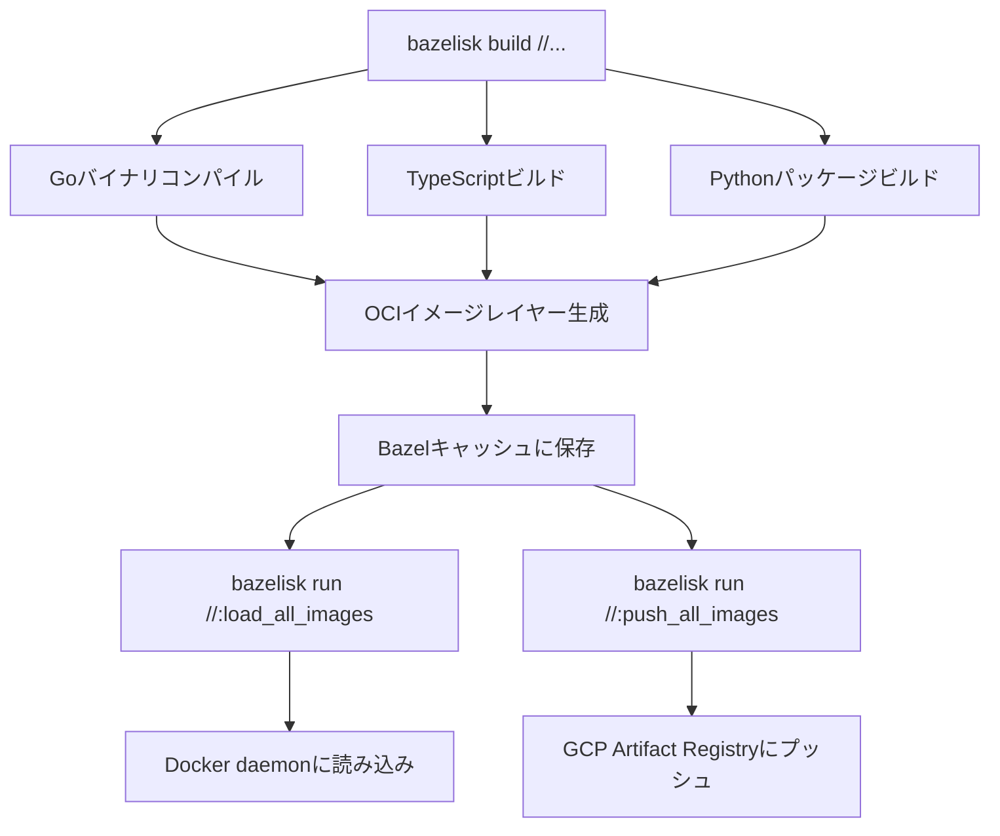
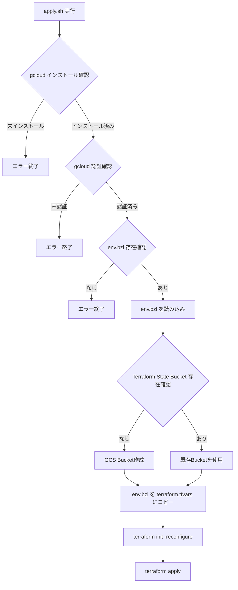
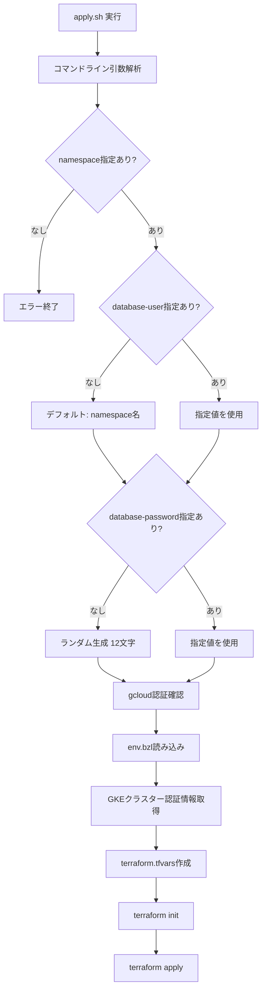
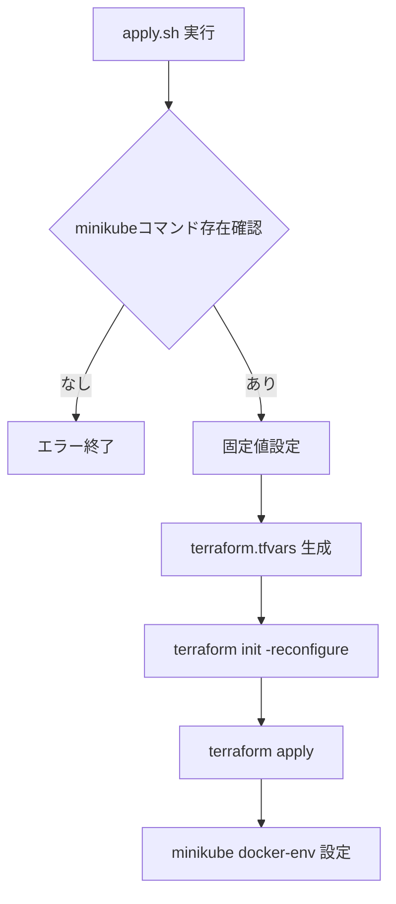
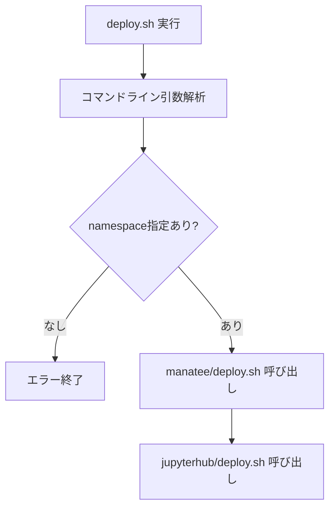
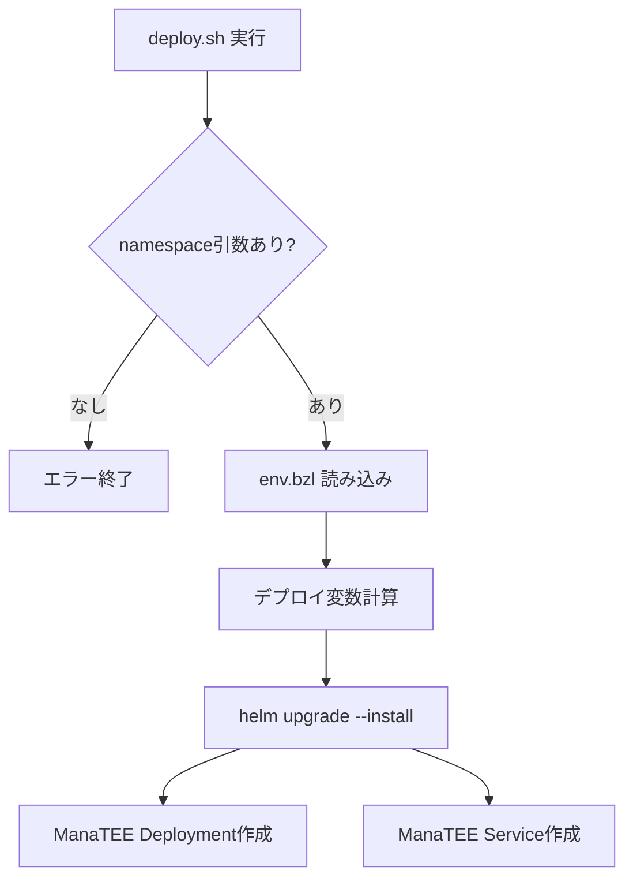
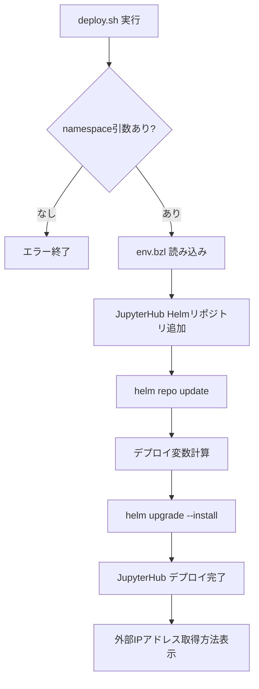
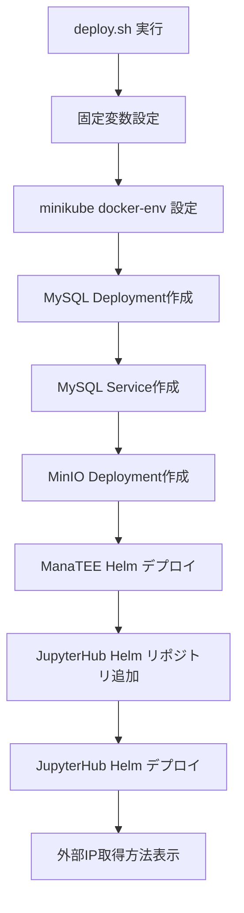

# ManaTEE ビルド・デプロイメント手順書

このドキュメントでは、ManaTEEプロジェクトのビルドからデプロイメントまでの全手順を詳細に説明します。

## 目次

1. [概要](#概要)
2. [環境別デプロイメント構成](#環境別デプロイメント構成)
3. [ビルドプロセス](#ビルドプロセス)
4. [リソース作成プロセス](#リソース作成プロセス)
5. [デプロイメントプロセス](#デプロイメントプロセス)
6. [各スクリプトの詳細解説](#各スクリプトの詳細解説)

---

## 概要

ManaTEEは**3層のインフラ構造**を持っています:

### レイヤー1: グローバルリソース (`resources/global/`)
- GCPプロジェクト全体で**1回だけ作成**する共有インフラ
- GKEクラスター、Cloud SQL、VPC、サービスアカウント等

### レイヤー2: デプロイメントリソース (`resources/deployment/`)
- **名前空間ごと**に作成するリソース
- Kubernetes Namespace、データベースユーザー、Docker Registry等

### レイヤー3: アプリケーション (`deployment/`)
- Helmチャートによるアプリケーションのデプロイ
- ManaTEE APIサーバー、Reconciler、JupyterHub

---

## 環境別デプロイメント構成

ManaTEEは3つのデプロイメント環境に対応しています:

| 環境 | 説明 | 使用スクリプト | TEEバックエンド |
|------|------|----------------|-----------------|
| **Minikube** | ローカル開発環境 | `build.sh` (自動一括実行) | Mock (K8s Job) |
| **GCP Dev** | GCP開発環境 | 手動実行 (`apply.sh` → `deploy.sh`) | Mock or Confidential Space |
| **GCP Prod** | GCP本番環境 | 手動実行 (`apply.sh` → `deploy.sh`) | Confidential Space |

---

## ビルドプロセス

### 1. Bazelビルドシステムの概要

ManaTEEは**Bazel**を使用してマルチ言語プロジェクト (Go/Python/TypeScript) をビルドします。

#### ビルドコマンドと役割

```bash
# 全ターゲットをビルド (バイナリ、イメージレイヤー生成)
bazelisk build //...

# ビルドしたイメージをローカルDockerにロード
bazelisk run //:load_all_images

# ビルドしたイメージをGCP Artifact Registryにプッシュ
bazelisk run //:push_all_images
```

#### ビルドされる主要コンポーネント

| コンポーネント | ビルドターゲット | 出力 |
|---------------|------------------|------|
| API Server | `//app/api:api` | Goバイナリ + `api:latest` イメージ |
| Reconciler | `//app/reconciler:reconciler` | Goバイナリ + `reconciler:latest` イメージ |
| Executor | `//app/executor:image` | `executor:latest` イメージ (scipy-notebookベース) |
| JupyterLab Extension | `//app/jupyterlab_manatee:image` | TypeScript/Python + `jupyterlab_manatee:latest` イメージ |

### 2. ビルドプロセスの詳細フロー



#### ビルド時の依存関係解決

1. **Go依存関係**: `go.mod` → `gazelle` が `BUILD.bazel` を自動生成
2. **Python依存関係**: `requirements.txt` → `rules_python` が解決
3. **TypeScript依存関係**: `package.json` → `rules_js` が解決

---

## リソース作成プロセス

### 1. グローバルリソース作成 (`resources/global/apply.sh`)

#### 実行タイミング
**GCPプロジェクトで最初の1回のみ実行**

#### スクリプトの処理フロー

```bash
cd resources/global
./apply.sh
```

#### `apply.sh` の詳細処理



#### 作成されるGCPリソース (Terraform)

| リソース | 説明 | ファイル |
|----------|------|----------|
| **VPCネットワーク** | プライベートネットワーク | `network.tf` |
| **VPCサブネット** | GKE用サブネット | `network.tf` |
| **GKEクラスター** | Kubernetes本体 (Confidential GKE, GPU/CPUノードプール) | `cluster.tf` |
| **Cloud SQL (MySQL 8.0)** | ジョブメタデータDB | `database.tf` |
| **GCS Bucket** | データ保存用 (`dcr-{env}-hub`) | `buckets.tf` |
| **Artifact Registry** | ユーザーイメージ用リポジトリ | `repositories.tf` |
| **Service Accounts** | GCP IAMサービスアカウント (4種類) | `service_accounts.tf` |
| **IAM Bindings** | 各サービスアカウントへの権限付与 | `iam.tf` |

#### 作成される4つのサービスアカウント

1. **`gcp_dcr_cluster_sa`**: GKEクラスターノード用
2. **`gcp_cvm_sa`**: Confidential VM (TEE) 用
3. **`gcp_dcr_pod_sa`**: ManaTEE Pod用 (Workload Identity)
4. **`gcp_jupyter_pod_sa`**: JupyterHub Pod用 (Workload Identity)

---

### 2. デプロイメントリソース作成 (`resources/deployment/apply.sh`)

#### 実行タイミング
**新しい名前空間を作成する度に実行** (例: チームごと、プロジェクトごと)

#### スクリプトの処理フロー

```bash
cd resources/deployment
./apply.sh --namespace=my-team --database-user=my-user --database-password=my-pass
```

#### `apply.sh` の詳細処理



#### 作成されるリソース

| リソース | 説明 | ファイル |
|----------|------|----------|
| **Kubernetes Namespace** | チーム専用の名前空間 | `namespace.tf` |
| **Cloud SQLデータベース** | 名前空間専用のDB | `db_account.tf` |
| **Cloud SQLユーザー** | DB接続用ユーザー | `db_account.tf` |
| **Artifact Registry** | 名前空間専用のDockerイメージリポジトリ | `repositories.tf` |
| **K8s Service Account** | ManaTEE Pod用 (Workload Identity設定済み) | `service_accounts.tf` |
| **K8s Service Account** | JupyterHub Pod用 (Workload Identity設定済み) | `service_accounts.tf` |
| **K8s Role** | 名前空間内の権限定義 | `role.tf` |
| **K8s RoleBinding** | Service AccountとRoleの紐付け | `role.tf` |
| **K8s ClusterRoleBinding** | クラスター全体の権限付与 | `cluster_rolebinding.tf` |
| **K8s Secret** | DB認証情報保存 | `secret.tf` |

#### Workload Identity の仕組み

```
K8s Service Account (dcr-k8s-pod-sa)
    ↓ (Workload Identity Binding)
GCP Service Account (dcr-pod-sa@{project}.iam.gserviceaccount.com)
    ↓ (IAM Roles)
GCP APIs (Cloud SQL, GCS, Compute Engine, etc.)
```

---

### 3. Minikube環境のリソース作成 (`resources/minikube/apply.sh`)

#### 実行タイミング
`build.sh` から自動的に呼び出される (手動実行も可能)

#### スクリプトの処理フロー

```bash
cd resources/minikube
./apply.sh
```

#### `apply.sh` の詳細処理



#### 作成されるリソース

| リソース | 説明 | 備考 |
|----------|------|------|
| **Kubernetes Namespace** | `manatee` 名前空間 | `namespace.tf` |
| **K8s Service Account** | `dcr-k8s-pod-sa` | `service_accounts.tf` |
| **K8s Service Account** | `jupyter-k8s-pod-sa` | `service_accounts.tf` |
| **K8s Role** | Pod権限定義 | `role.tf` |
| **K8s RoleBinding** | 権限バインディング | `role.tf` |
| **K8s Secret** | DB認証情報 (ランダム生成) | `secret.tf` |

**注意**: Minikube環境ではGCPリソースは作成されません。代わりにローカルのMySQL/MinIOを使用します。

---

## デプロイメントプロセス

### 1. GCP環境へのデプロイ (`deployment/deploy.sh`)

#### 実行タイミング
リソース作成後、アプリケーションをデプロイする際に実行

#### スクリプトの処理フロー

```bash
cd deployment
./deploy.sh --namespace=my-team --debug=false
```

#### `deploy.sh` の詳細処理



#### 呼び出される子スクリプト

1. **`deployment/manatee/deploy.sh`** - ManaTEE本体のデプロイ
2. **`deployment/jupyterhub/deploy.sh`** - JupyterHubのデプロイ

---

### 2. ManaTEE本体のデプロイ (`deployment/manatee/deploy.sh`)

#### スクリプトの処理フロー

```bash
cd deployment/manatee
./deploy.sh <namespace> <debug>
```

#### `deploy.sh` の詳細処理



#### Helmで設定される主要パラメータ

| パラメータ | 説明 | 例 |
|-----------|------|-----|
| `apiImage.repository` | APIサーバーイメージ | `us-docker.pkg.dev/{project}/{repo}/manatee-api` |
| `apiImage.tag` | イメージタグ | `latest` |
| `monitorImage.repository` | Reconcilerイメージ | `us-docker.pkg.dev/{project}/{repo}/manatee-reconciler` |
| `serviceAccount.name` | K8s Service Account名 | `dcr-k8s-pod-sa` |
| `cloudSql.connection_name` | Cloud SQL接続名 | `{project}:{region}:{instance}` |
| `namespace` | デプロイ先Namespace | `my-team` |
| `config.env` | 環境名 | `dev` or `prod` |
| `config.projectId` | GCPプロジェクトID | `my-project` |
| `config.debug` | デバッグモード | `true` or `false` |

#### デプロイされるKubernetesリソース

- **Deployment (API Server)**: Hertz Webサーバー (REST API)
- **Deployment (Reconciler)**: バックグラウンドジョブ管理
- **Service (API)**: ClusterIP サービス
- **Cloud SQL Proxy Sidecar**: Cloud SQLへの接続プロキシ

---

### 3. JupyterHubのデプロイ (`deployment/jupyterhub/deploy.sh`)

#### スクリプトの処理フロー

```bash
cd deployment/jupyterhub
./deploy.sh <namespace>
```

#### `deploy.sh` の詳細処理



#### Helmで設定される主要パラメータ

| パラメータ | 説明 | 例 |
|-----------|------|-----|
| `singleuser.image.name` | JupyterLabイメージ | `us-docker.pkg.dev/{project}/{repo}/manatee-jupyterlab-singleuser` |
| `singleuser.image.tag` | イメージタグ | `latest` |
| `singleuser.serviceAccountName` | K8s Service Account名 | `jupyter-k8s-pod-sa` |
| `singleuser.extraEnv.DATA_CLEAN_ROOM_HOST` | ManaTEE APIエンドポイント | `http://manatee.{namespace}.svc.cluster.local` |
| `singleuser.extraEnv.EXECUTION_STAGE` | 実行ステージ1 | `"1"` |
| `singleuser.extraEnv.MANATEE_EXTRA_ENV_EXECUTION_STAGE` | 実行ステージ2 | `"2"` |
| `singleuser.storage.capacity` | 永続ボリュームサイズ | `20Gi` |

#### デプロイされるKubernetesリソース

- **Hub Deployment**: JupyterHub本体 (認証、プロキシ管理)
- **Proxy Deployment**: ConfigurableHTTPProxy (トラフィック振り分け)
- **Service (proxy-public)**: LoadBalancer (外部アクセス用)
- **PersistentVolumeClaim**: 各ユーザーのホームディレクトリ
- **ConfigMap**: JupyterHub設定

---

### 4. Minikube環境へのデプロイ (`deployment/minikube/deploy.sh`)

#### 実行タイミング
`build.sh` から自動的に呼び出される (手動実行も可能)

#### スクリプトの処理フロー

```bash
cd deployment/minikube
./deploy.sh
```

#### `deploy.sh` の詳細処理



#### GCP環境との主な違い

| 項目 | GCP環境 | Minikube環境 |
|------|---------|-------------|
| **データベース** | Cloud SQL (マネージド) | MySQL Deployment (Pod) |
| **ストレージ** | GCS (マネージド) | MinIO Deployment (Pod) |
| **TEEバックエンド** | Confidential Space | Mock (K8s Job) |
| **レジストリ** | Artifact Registry | Minikube内部レジストリ |
| **イメージ取得** | Pull (ネットワーク経由) | Never (ローカルビルド) |
| **Service Account** | Workload Identity連携 | K8s Service Account のみ |

#### デプロイされる追加リソース (Minikube専用)

```yaml
# MySQL Deployment
- Deployment: mysql
- Service: mysql-service (ClusterIP, port 3306)
- PersistentVolumeClaim: mysql-pvc (10Gi)

# MinIO Deployment
- Deployment: minio
- Service: minio-service (ClusterIP, port 9000/9001)
- PersistentVolumeClaim: minio-pvc (10Gi)
```

#### Minikube固有の設定

```bash
# Helm values (ManaTEE)
--set config.teeBackend=MOCK          # Mock TEE backend使用
--set config.registryType=MINIKUBE    # Minikubeレジストリ使用
--set config.storageType=MINIO        # MinIO使用
--set config.minioEndpoint=minio-service:9000
--set mysql.host=mysql-service        # MySQL Pod接続
--set useMinikube=true                # Minikubeフラグ有効化

# Helm values (JupyterHub)
--set singleuser.image.pullPolicy=Never    # イメージをPullしない
--set prePuller.continuous.enabled=false   # プリプーラー無効
--set prePuller.hook.enabled=false         # フック無効
```

---

## 各スクリプトの詳細解説

### `build.sh` (Minikube環境構築スクリプト)

**目的**: Minikube環境を完全自動でセットアップ

#### 処理ステップ

1. **前提条件チェック**
   - Docker インストール確認 → なければ自動インストール
   - Minikube インストール確認 → なければ自動インストール
   - kubectl インストール確認 → なければ自動インストール
   - bazelisk インストール確認 → なければ自動インストール
   - socat インストール確認 → なければ自動インストール
   - mc (MinIO Client) インストール確認 → なければ自動インストール

2. **Minikubeクラスター起動**
   ```bash
   minikube start --cpus=8 --memory=12g --disk-size=50g
   ```

3. **Minikubeレジストリアドオン有効化**
   ```bash
   minikube addons enable registry
   kubectl port-forward --namespace kube-system service/registry 5000:80 &
   ```

4. **Kubernetes Namespaceリソース作成**
   ```bash
   cd resources/minikube && ./apply.sh
   ```

5. **Bazelビルド・イメージロード**
   ```bash
   bazelisk build //...
   bazelisk run //:load_all_images
   ```

6. **イメージのMinikubeへのロード**
   ```bash
   eval $(minikube docker-env)
   docker tag api:latest docker.io/library/api:latest
   docker tag reconciler:latest docker.io/library/reconciler:latest
   docker tag executor:latest docker.io/library/executor:latest
   docker tag jupyterlab_manatee:latest docker.io/library/jupyterlab_manatee:latest
   ```

7. **アプリケーションデプロイ**
   ```bash
   cd deployment/minikube && ./deploy.sh
   ```

8. **完了メッセージ表示**
   - JupyterHubアクセス方法
   - MySQL接続方法
   - MinIO接続方法

---

### `resources/global/apply.sh` (グローバルリソース作成)

**目的**: GCPプロジェクト全体の共有インフラを構築

#### 主要チェック項目

1. `gcloud` コマンドインストール確認
2. `gcloud` 認証確認 (`gcloud auth list`)
3. `env.bzl` ファイル存在確認
4. Terraform State用GCS Bucket存在確認 → なければ作成

#### Terraform State管理

```bash
# State Bucket名: dcr-tf-state-{env}
# State Prefix: cloud
gsutil mb -l us gs://dcr-tf-state-${env}

terraform init -reconfigure \
  -backend-config="bucket=dcr-tf-state-${env}" \
  -backend-config="prefix=cloud"
```

#### 実行例

```bash
cd resources/global
./apply.sh
```

---

### `resources/deployment/apply.sh` (デプロイメントリソース作成)

**目的**: 名前空間ごとの専用リソースを作成

#### 必須引数

- `--namespace=<name>`: 名前空間名 (必須)
- `--database-user=<user>`: DBユーザー名 (オプション、デフォルト: namespace名)
- `--database-password=<pass>`: DBパスワード (オプション、デフォルト: ランダム12文字)

#### Terraform State管理

```bash
# State Bucket名: dcr-tf-state-{env}
# State Prefix: {namespace}  ← 名前空間ごとに分離
terraform init -reconfigure \
  -backend-config="bucket=dcr-tf-state-${env}" \
  -backend-config="prefix=${namespace}"
```

#### 実行例

```bash
cd resources/deployment

# 最小実行 (DB認証情報は自動生成)
./apply.sh --namespace=my-team

# 完全指定
./apply.sh \
  --namespace=my-team \
  --database-user=my-user \
  --database-password=my-secure-pass
```

---

### `deployment/deploy.sh` (アプリケーションデプロイ統合スクリプト)

**目的**: ManaTEEとJupyterHubを順次デプロイ

#### 処理フロー

```bash
# 1. ManaTEEデプロイ
cd manatee && ./deploy.sh $namespace $debug

# 2. JupyterHubデプロイ
cd jupyterhub && ./deploy.sh $namespace
```

#### 実行例

```bash
cd deployment

# デバッグモード無効
./deploy.sh --namespace=my-team

# デバッグモード有効
./deploy.sh --namespace=my-team --debug=true
```

---

## フルデプロイメントシーケンス

### GCP環境へのデプロイ (初回)

```bash
# 1. env.bzl 設定ファイル作成
cat > env.bzl <<EOF
project_id = "your-gcp-project"
region = "us-central1"
zone = "us-central1-a"
env = "dev"
EOF

# 2. グローバルリソース作成 (1回のみ)
cd resources/global
./apply.sh

# 3. コンテナイメージビルド & プッシュ
cd ../..
bazelisk build //...
bazelisk run //:push_all_images

# 4. デプロイメントリソース作成 (名前空間ごと)
cd resources/deployment
./apply.sh --namespace=my-team

# 5. アプリケーションデプロイ
cd ../../deployment
./deploy.sh --namespace=my-team

# 6. 外部IPアドレス取得
kubectl --namespace=my-team get service proxy-public
```

### Minikube環境へのデプロイ (ワンコマンド)

```bash
# env.bzl 作成
cat > env.bzl <<EOF
project_id = "mock-gcp-project-id"
region = "us-west2"
zone = "us-west2-a"
env = "minikube"
EOF

# 全自動セットアップ
./build.sh
```

---

## トラブルシューティング

### よくあるエラーと対処法

#### 1. `env.bzl` が見つからない

```
Error: Variables file does not exist.
```

**対処法**: プロジェクトルートに `env.bzl` を作成

```bash
cat > env.bzl <<EOF
project_id = "your-project-id"
region = "us-central1"
zone = "us-central1-a"
env = "dev"
EOF
```

#### 2. `gcloud` 認証エラー

```
Error: No active gcloud account found.
```

**対処法**: GCPアカウントで認証

```bash
gcloud auth login
gcloud config set project your-project-id
```

#### 3. Docker permissionエラー (Minikube)

```
permission denied while trying to connect to the Docker daemon
```

**対処法**: ログアウト → ログイン (dockerグループ反映)

```bash
# ログアウトして再ログイン
exit
# または
sudo reboot
```

#### 4. Minikubeメモリ不足

```
Exiting due to MK_USAGE: Insufficient memory
```

**対処法**: Minikubeクラスターを削除して再作成

```bash
minikube delete
minikube start --cpus=8 --memory=12g --disk-size=50g
```

#### 5. Terraform State Lock

```
Error: Error acquiring the state lock
```

**対処法**: 強制アンロック (注意: 複数人が同時実行した場合のみ)

```bash
terraform force-unlock <LOCK_ID>
```

---

## まとめ

### 環境別デプロイメントコマンド早見表

| 環境 | コマンド | 備考 |
|------|----------|------|
| **Minikube** | `./build.sh` | 全自動 |
| **GCP (初回)** | `global/apply.sh` → `build` → `push` → `deployment/apply.sh` → `deploy.sh` | 手動実行 |
| **GCP (2回目以降)** | `build` → `push` → `deploy.sh` | イメージ更新のみ |

### 主要スクリプト役割まとめ

| スクリプト | 役割 | 実行頻度 |
|-----------|------|----------|
| `build.sh` | Minikube環境全自動セットアップ | 初回のみ |
| `resources/global/apply.sh` | GCPグローバルリソース作成 | 1回のみ |
| `resources/deployment/apply.sh` | 名前空間リソース作成 | 名前空間ごと |
| `resources/minikube/apply.sh` | Minikube K8sリソース作成 | build.shから自動 |
| `deployment/deploy.sh` | アプリケーション統合デプロイ | イメージ更新時 |
| `deployment/manatee/deploy.sh` | ManaTEE本体デプロイ | deploy.shから自動 |
| `deployment/jupyterhub/deploy.sh` | JupyterHubデプロイ | deploy.shから自動 |
| `deployment/minikube/deploy.sh` | Minikube統合デプロイ | build.shから自動 |

---

## 参考資料

- [Terraform Documentation](https://www.terraform.io/docs)
- [Helm Documentation](https://helm.sh/docs/)
- [Bazel Documentation](https://bazel.build/docs)
- [JupyterHub Documentation](https://jupyterhub.readthedocs.io/)
- [GKE Workload Identity](https://cloud.google.com/kubernetes-engine/docs/how-to/workload-identity)
- [GCP Confidential Computing](https://cloud.google.com/confidential-computing)
