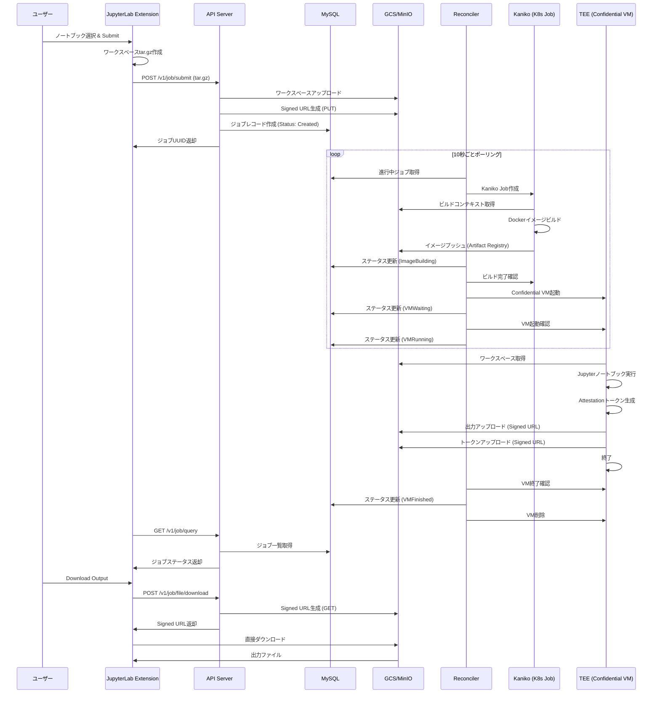
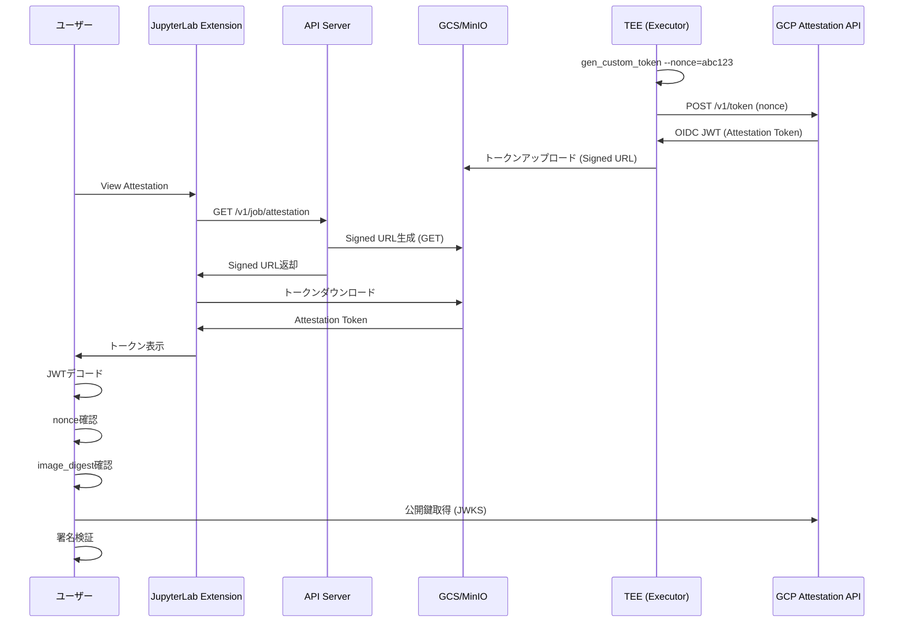

# ManaTEE コンポーネント機能仕様書

このドキュメントでは、ManaTEEプロジェクトの4つの主要コンポーネント (API Server, Reconciler, Executor, JupyterLab Extension) の機能と役割を詳細に説明します。

---

## 目次

1. [アーキテクチャ概要](#アーキテクチャ概要)
2. [API Server (`app/api`)](#api-server-appapi)
3. [Reconciler (`app/reconciler`)](#reconciler-appreconciler)
4. [Executor (`app/executor`)](#executor-appexecutor)
5. [JupyterLab Extension (`app/jupyterlab_manatee`)](#jupyterlab-extension-appjupyterlab_manatee)
6. [コンポーネント間の通信フロー](#コンポーネント間の通信フロー)
7. [データフロー図](#データフロー図)

---

## アーキテクチャ概要

ManaTEEは**Data Clean Room (DCR)** フレームワークとして、機密データを安全に処理するための4層アーキテクチャを採用しています:

```
┌─────────────────────────────────────────────────────────┐
│  JupyterLab Extension (ユーザーインターフェース)        │
│  - Jupyterノートブック選択                                │
│  - ジョブ投入・管理・結果ダウンロード                      │
└──────────────────┬──────────────────────────────────────┘
                   │ HTTP REST API
┌──────────────────▼──────────────────────────────────────┐
│  API Server (ジョブ受付・メタデータ管理)                  │
│  - ジョブ投入受付                                         │
│  - ジョブステータス管理                                    │
│  - ファイルアップロード/ダウンロード                       │
└──────────────────┬──────────────────────────────────────┘
                   │ MySQL (ジョブメタデータ)
┌──────────────────▼──────────────────────────────────────┐
│  Reconciler (ジョブオーケストレーター)                    │
│  - イメージビルド管理 (Kaniko)                            │
│  - TEEインスタンス起動・監視                              │
│  - ジョブライフサイクル管理                                │
└──────────────────┬──────────────────────────────────────┘
                   │ Kubernetes Job / GCP Compute API
┌──────────────────▼──────────────────────────────────────┐
│  Executor (TEE実行環境)                                  │
│  - ユーザーコード実行 (Jupyter Notebook)                  │
│  - Attestationトークン生成                                │
│  - 結果のセキュアアップロード                             │
└─────────────────────────────────────────────────────────┘
```

---

## API Server (`app/api`)

### 概要

**役割**: ユーザーからのジョブ投入リクエストを受け付け、ジョブのメタデータをデータベースに保存し、ジョブのライフサイクルを管理するREST APIサーバー

**技術スタック**:
- **フレームワーク**: CloudWeGo Hertz (高性能GoベースのHTTPフレームワーク)
- **ポート**: `8080`
- **データベース**: MySQL 8.0 (Cloud SQL or ローカルMySQL)
- **ストレージ**: GCS (Google Cloud Storage) or MinIO

---

### 主要機能

#### 1. ジョブ投入 (`POST /v1/job/submit/`)

**処理フロー**:
```go
// Handler: app/api/biz/handler/job/job_handler.go::SubmitJob
func SubmitJob(ctx context.Context, c *app.RequestContext)
```

1. **リクエスト受信**
   - ユーザーワークスペース (`workspace.tar.gz`)
   - Jupyterノートブックファイル名 (`filename`)
   - 作成者 (`creator`)
   - 環境変数 (`envs[]`)
   - 認証トークン (`Authorization` header)

2. **同時実行数制限チェック**
   ```go
   jobInList, err := db.GetInProgressJobs(creator)
   if len(jobInList) > 2 {
       return errors.Wrap(fmt.Errorf("ReachJobLimitErrMsg"), "")
   }
   ```
   - 1ユーザーあたり最大3ジョブまで同時実行可能

3. **Dockerfile自動生成**
   ```go
   dockerFileContent := js.generateDockerfile(keys)
   buildctx, err := js.addDockerfileToTarGz(userWorkspace, string(dockerFileContent))
   ```
   - ユーザー指定の環境変数を含むDockerfileを生成
   - ワークスペースtar.gzにDockerfileを追加

4. **ビルドコンテキストのアップロード**
   ```go
   remotePath := fmt.Sprintf("%s/%s-workspace.tar.gz", creator, creator)
   err = js.storage.UploadFile(buildctx, remotePath, false)
   ```
   - GCS/MinIOにビルドコンテキストを保存

5. **Signed URL生成**
   - **出力用Signed URL** (`PUT`): Executorが結果をアップロードするため
   - **Attestationトークン用Signed URL** (`PUT`): Executor がトークンをアップロードするため
   - 有効期限: 6時間

6. **ジョブレコード作成**
   ```go
   jobUUID := uuid.NewUUID()
   db.CreateJob(&db.Job{
       UUID:       jobUUID.String(),
       Creator:    creator,
       JobStatus:  int(job.JobStatus_Created),
       Buildctx:   buildctxpath,
       ExtraEnvs:  extraEnvs,
       // ...
   })
   ```
   - ステータス: `Created` (Reconcilerが処理待ち)

7. **レスポンス返却**
   ```json
   {
       "code": 0,
       "msg": "Success",
       "uuid": "550e8400-e29b-41d4-a716-446655440000"
   }
   ```

---

#### 2. ジョブクエリ (`POST /v1/job/query/`)

**処理フロー**:
```go
// Handler: app/api/biz/handler/job/job_handler.go::QueryJob
func QueryJob(ctx context.Context, c *app.RequestContext)
```

**リクエスト**:
```json
{
    "creator": "user@example.com",
    "page": 1,
    "page_size": 10
}
```

**レスポンス**:
```json
{
    "code": 0,
    "msg": "Success",
    "jobs": [
        {
            "id": 123,
            "uuid": "550e8400-e29b-41d4-a716-446655440000",
            "creator": "user@example.com",
            "job_status": 5,  // VMRunning
            "created_at": "2025-10-02T10:00:00Z",
            "updated_at": "2025-10-02T10:05:00Z",
            "docker_image": "us-docker.pkg.dev/project/repo/user-550e8400:latest",
            "instance_name": "user-550e8400"
        }
    ],
    "total": 1
}
```

**ジョブステータス**:
| ステータス | 値 | 説明 |
|-----------|-----|------|
| `Created` | 0 | ジョブ作成完了 (イメージビルド待ち) |
| `ImageBuilding` | 1 | Kanikoでイメージビルド中 |
| `ImageBuildingFailed` | 2 | イメージビルド失敗 |
| `VMWaiting` | 3 | TEEインスタンス起動待ち |
| `VMLaunchFailed` | 4 | TEEインスタンス起動失敗 |
| `VMRunning` | 5 | TEEインスタンス実行中 |
| `VMFinished` | 6 | TEEインスタンス正常終了 |
| `VMFailed` | 7 | TEEインスタンス異常終了 |

---

#### 3. ジョブ削除 (`POST /v1/job/delete/`)

**処理フロー**:
```go
// Handler: app/api/biz/handler/job/job_handler.go::DeleteJob
func DeleteJob(ctx context.Context, c *app.RequestContext)
```

**リクエスト**:
```json
{
    "id": 123,
    "creator": "user@example.com"
}
```

**処理内容**:
- データベースからジョブレコードを論理削除
- 実行中のTEEインスタンスは削除しない (Reconcilerが自動クリーンアップ)

---

#### 4. 出力ダウンロード (`POST /v1/job/file/download/`)

**処理フロー**:
```go
// Handler: app/api/biz/handler/job/job_handler.go::DownloadJobOutput
func DownloadJobOutput(ctx context.Context, c *app.RequestContext)
```

**リクエスト**:
```json
{
    "id": 123,
    "creator": "user@example.com"
}
```

**レスポンス**:
```json
{
    "code": 0,
    "msg": "Success",
    "signed_url": "https://storage.googleapis.com/bucket/path/to/output?X-Goog-Signature=...",
    "filename": "out-550e8400-notebook.ipynb"
}
```

**処理内容**:
1. ジョブステータスが `VMFinished` であることを確認
2. GCS/MinIOから出力ファイルの `GET` Signed URLを生成 (有効期限: 1時間)
3. クライアントが直接GCS/MinIOからダウンロード

---

#### 5. Attestationレポート取得 (`POST /v1/job/attestation/`)

**処理フロー**:
```go
// Handler: app/api/biz/handler/job/job_handler.go::QueryJobAttestationReport
func QueryJobAttestationReport(ctx context.Context, c *app.RequestContext)
```

**リクエスト**:
```json
{
    "id": 123,
    "creator": "user@example.com"
}
```

**レスポンス**:
```json
{
    "code": 0,
    "msg": "Success",
    "signed_url": "https://storage.googleapis.com/bucket/path/to/token?X-Goog-Signature=..."
}
```

**処理内容**:
- Executorが生成したAttestationトークン (OIDC JWT) のダウンロードURLを返す
- クライアントはこのトークンを検証することで、コードがTEE環境で実行されたことを証明できる

---

#### 6. ヘルスチェック (`GET /health`)

**処理フロー**:
```go
// Handler: app/api/biz/handler/health.go::Health
func Health(ctx context.Context, c *app.RequestContext)
```

**レスポンス**:
```json
{
    "status": "ok"
}
```

---

### データベーススキーマ (Job テーブル)

```sql
CREATE TABLE `job` (
  `id` bigint(20) NOT NULL AUTO_INCREMENT,
  `uuid` varchar(128) NOT NULL,
  `creator` varchar(256) NOT NULL,
  `job_status` int(11) NOT NULL DEFAULT 0,
  `created_at` datetime NOT NULL,
  `updated_at` datetime NOT NULL,
  `buildctx` text,
  `docker_image` text,
  `docker_image_digest` text,
  `instance_name` varchar(256),
  `extra_envs` json,
  PRIMARY KEY (`id`),
  UNIQUE KEY `uuid` (`uuid`),
  KEY `idx_creator_status` (`creator`, `job_status`)
);
```

---

### API Server のデプロイ設定

**Kubernetes Deployment**:
```yaml
apiVersion: apps/v1
kind: Deployment
metadata:
  name: manatee-api
spec:
  replicas: 1
  template:
    spec:
      serviceAccountName: dcr-k8s-pod-sa  # Workload Identity
      containers:
      - name: api
        image: us-docker.pkg.dev/project/repo/manatee-api:latest
        ports:
        - containerPort: 8080
        env:
        - name: ENV
          value: "dev"
        - name: PROJECT_ID
          value: "your-project"
      - name: cloud-sql-proxy  # Cloud SQL Proxy Sidecar
        image: gcr.io/cloud-sql-connectors/cloud-sql-proxy:latest
        args:
        - "--port=3306"
        - "your-project:region:db-instance"
```

---

## Reconciler (`app/reconciler`)

### 概要

**役割**: バックグラウンドで動作するジョブオーケストレーター。データベースをポーリングして、ジョブのライフサイクルを管理し、イメージビルドとTEEインスタンス起動を調整する。

**技術スタック**:
- **言語**: Go
- **実行間隔**: 10秒ごとにポーリング
- **Kubernetes API**: Job (Kaniko), Batch API
- **GCP API**: Compute Engine API (Confidential VM)

---

### 主要機能

#### 1. ジョブポーリング

**処理フロー**:
```go
// main.go::main
func main() {
    reconciler := NewReconciler(ctx)
    for {
        hlog.Info("Reconciling...")
        reconciler.Reconcile(ctx)
        time.Sleep(10 * time.Second)
    }
}
```

**Reconcile処理**:
```go
// reconciler.go::Reconcile
func (r *ReconcilerImpl) Reconcile(ctx context.Context) {
    jobs, err := db.GetAllInProgressJobs()
    
    for _, j := range jobs {
        // タイムアウトチェック (6時間)
        if time.Since(j.CreatedAt) > 6*time.Hour {
            r.tee.CleanUpInstance(j.InstanceName)
            j.JobStatus = int(job.JobStatus_VMFailed)
            db.UpdateJob(j)
            continue
        }
        
        // ステータスごとの処理
        switch j.JobStatus {
        case int(job.JobStatus_Created):
            r.handleCreatedJob(j)
        case int(job.JobStatus_ImageBuilding):
            r.handleImageBuildingJob(j)
        case int(job.JobStatus_VMWaiting):
        case int(job.JobStatus_VMRunning):
            r.handleRunningJob(j)
        }
        
        db.UpdateJob(j)
        
        // クリーンアップ
        if j.JobStatus == int(job.JobStatus_VMFinished) || 
           j.JobStatus == int(job.JobStatus_VMFailed) {
            r.tee.CleanUpInstance(j.InstanceName)
        }
    }
}
```

---

#### 2. イメージビルド管理 (Kaniko)

**処理フロー**:
```go
// reconciler.go::handleCreatedJob
func (r *ReconcilerImpl) handleCreatedJob(j *db.Job) error {
    registry := registry.GetRegistry()
    baseImage := registry.BaseImage()
    imageTag := fmt.Sprintf("%s/%s-%s:latest", registry.Url(), j.Creator, j.UUID)
    
    err := r.builder.BuildImage(j, baseImage, imageTag)
    if err != nil {
        return err
    }
    j.JobStatus = int(job.JobStatus_ImageBuilding)
    return nil
}
```

**Kaniko Kubernetes Job作成**:
```go
// imagebuilder/kaniko.go::BuildImage
func (b *KanikoImageBuilder) BuildImage(j *db.Job, baseImage string, imageTag string) error {
    k8sJob := &batchv1.Job{
        ObjectMeta: metav1.ObjectMeta{
            Name:      "kaniko-" + j.UUID,
            Namespace: b.namespace,
        },
        Spec: batchv1.JobSpec{
            Template: corev1.PodTemplateSpec{
                Spec: corev1.PodSpec{
                    ServiceAccountName: "dcr-k8s-pod-sa",
                    Containers: []corev1.Container{
                        {
                            Name:  "kaniko",
                            Image: "gcr.io/kaniko-project/executor:latest",
                            Args: []string{
                                "--dockerfile=Dockerfile",
                                "--context=" + j.Buildctx,  // GCS path
                                "--destination=" + imageTag,
                                "--cache=true",
                            },
                        },
                    },
                    RestartPolicy: corev1.RestartPolicyNever,
                },
            },
        },
    }
    
    _, err := b.clientSet.BatchV1().Jobs(b.namespace).Create(b.ctx, k8sJob, metav1.CreateOptions{})
    return err
}
```

**イメージビルドステータス監視**:
```go
// imagebuilder/kaniko.go::CheckImageBuilderStatusAndGetInfo
func (b *KanikoImageBuilder) CheckImageBuilderStatusAndGetInfo(uuid string) (bool, *ImageInfo, error) {
    k8sJobName := "kaniko-" + uuid
    k8sJob, err := b.clientSet.BatchV1().Jobs(b.namespace).Get(b.ctx, k8sJobName, metav1.GetOptions{})
    
    if len(k8sJob.Status.Conditions) == 0 {
        return false, nil, nil  // Still running
    }
    
    if k8sJob.Status.Conditions[0].Type == batchv1.JobComplete {
        image, digest, err := b.getImageDigest(k8sJob.Name)
        return true, &ImageInfo{Image: image, Digest: digest}, nil
    }
    
    return true, nil, fmt.Errorf("build failed")
}
```

**イメージダイジェスト取得**:
```go
// imagebuilder/kaniko.go::getImageDigest
func (b *KanikoImageBuilder) getImageDigest(jobName string) (string, string, error) {
    pods, _ := b.clientSet.CoreV1().Pods(b.namespace).List(b.ctx, metav1.ListOptions{
        LabelSelector: "job-name=" + jobName,
    })
    
    req := b.clientSet.CoreV1().Pods(b.namespace).GetLogs(pods.Items[0].Name, &corev1.PodLogOptions{})
    podLogs, _ := req.Stream(b.ctx)
    defer podLogs.Close()
    
    scanner := bufio.NewScanner(podLogs)
    digestRegex := regexp.MustCompile(`digest:\s*(.+)`)
    
    for scanner.Scan() {
        line := scanner.Text()
        if matches := digestRegex.FindStringSubmatch(line); len(matches) > 1 {
            return imageTag, matches[1], nil
        }
    }
    
    return "", "", fmt.Errorf("digest not found in logs")
}
```

---

#### 3. TEEインスタンス起動・監視

**処理フロー**:
```go
// reconciler.go::handleImageBuildingJob
func (r *ReconcilerImpl) handleImageBuildingJob(j *db.Job) error {
    done, info, err := r.builder.CheckImageBuilderStatusAndGetInfo(j.UUID)
    if !done {
        return nil
    }
    
    if info != nil {
        j.DockerImage = info.Image
        j.DockerImageDigest = info.Digest
        instanceName := fmt.Sprintf("%s-%s", j.Creator, j.UUID)
        
        err := r.tee.LaunchInstance(instanceName, j.DockerImage, j.DockerImageDigest, j.ExtraEnvs)
        if err != nil {
            j.JobStatus = int(job.JobStatus_VMLaunchFailed)
            return nil
        }
        
        j.InstanceName = instanceName
        j.JobStatus = int(job.JobStatus_VMWaiting)
    } else {
        j.JobStatus = int(job.JobStatus_ImageBuildingFailed)
    }
    return nil
}
```

**GCP Confidential VM起動**:
```go
// tee_backend/confidential_space.go::LaunchInstance
func (c *TEEProviderGCPConfidentialSpace) LaunchInstance(instanceName string, image string, digest string, extraEnvs map[string]string) error {
    req := &computepb.InsertInstanceRequest{
        Project: c.projectId,
        Zone:    c.zone,
        InstanceResource: &computepb.Instance{
            Name:        proto.String(instanceName),
            MachineType: proto.String("n2d-standard-2"),
            ConfidentialInstanceConfig: &computepb.ConfidentialInstanceConfig{
                EnableConfidentialCompute: proto.Bool(true),
            },
            ServiceAccounts: []*computepb.ServiceAccount{
                {
                    Email: proto.String(c.saEmail),
                    Scopes: []string{"https://www.googleapis.com/auth/cloud-platform"},
                },
            },
            Disks: []*computepb.AttachedDisk{
                {
                    Boot:       proto.Bool(true),
                    AutoDelete: proto.Bool(true),
                    InitializeParams: &computepb.AttachedDiskInitializeParams{
                        SourceImage: proto.String("projects/confidential-space-images/global/images/family/confidential-space"),
                    },
                },
            },
            Metadata: &computepb.Metadata{
                Items: []*computepb.Items{
                    {
                        Key:   proto.String("tee-container-log-redirect"),
                        Value: proto.String("true"),
                    },
                    {
                        Key:   proto.String("tee-image-reference"),
                        Value: proto.String(image + "@" + digest),
                    },
                    // extraEnvs を環境変数として設定
                },
            },
        },
    }
    
    op, err := c.client.Insert(c.ctx, req)
    if err != nil {
        return err
    }
    
    return op.Wait(c.ctx)
}
```

**インスタンスステータス監視**:
```go
// tee_backend/confidential_space.go::GetInstanceStatus
func (c *TEEProviderGCPConfidentialSpace) GetInstanceStatus(instanceName string) (string, error) {
    req := &computepb.GetInstanceRequest{
        Project:  c.projectId,
        Zone:     c.zone,
        Instance: instanceName,
    }
    resp, err := c.client.Get(c.ctx, req)
    if err != nil {
        return "", err
    }
    
    return *resp.Status, nil  // "RUNNING" or "TERMINATED"
}
```

**ステータス更新ロジック**:
```go
// reconciler.go::handleRunningJob
func (r *ReconcilerImpl) handleRunningJob(j *db.Job) error {
    instanceStatus, err := r.tee.GetInstanceStatus(j.InstanceName)
    
    if j.JobStatus == int(job.JobStatus_VMWaiting) && instanceStatus == "RUNNING" {
        j.JobStatus = int(job.JobStatus_VMRunning)
    } else if instanceStatus == "TERMINATED" {
        j.JobStatus = int(job.JobStatus_VMFinished)
    }
    
    return nil
}
```

---

#### 4. TEEバックエンドの種類

Reconcilerは環境変数 `TEE_BACKEND` に応じて異なるTEEプロバイダーを使用します:

| 環境変数値 | プロバイダー | 説明 |
|-----------|------------|------|
| `MOCK` | MockTeeBackend | Kubernetes JobでTEE実行をシミュレート (開発環境) |
| `GCP` | GCPConfidentialSpace | GCP Confidential Computing (本番環境) |
| (未設定) | MockTeeBackend | デフォルト |

**Mock TEE Backend**:
```go
// tee_backend/mock_teebackend.go::LaunchInstance
func (m *MockTeeBackend) LaunchInstance(instanceName string, image string, digest string, extraEnvs map[string]string) error {
    k8sJob := &batchv1.Job{
        ObjectMeta: metav1.ObjectMeta{
            Name:      instanceName,
            Namespace: m.namespace,
        },
        Spec: batchv1.JobSpec{
            Template: corev1.PodTemplateSpec{
                Spec: corev1.PodSpec{
                    ServiceAccountName: "dcr-k8s-pod-sa",
                    Containers: []corev1.Container{
                        {
                            Name:  "executor",
                            Image: image,
                            Env:   convertEnvs(extraEnvs),
                        },
                    },
                    RestartPolicy: corev1.RestartPolicyNever,
                },
            },
        },
    }
    
    _, err := m.clientSet.BatchV1().Jobs(m.namespace).Create(m.ctx, k8sJob, metav1.CreateOptions{})
    return err
}
```

---

### Reconciler のデプロイ設定

**Kubernetes Deployment**:
```yaml
apiVersion: apps/v1
kind: Deployment
metadata:
  name: manatee-reconciler
spec:
  replicas: 1
  template:
    spec:
      serviceAccountName: dcr-k8s-pod-sa
      containers:
      - name: reconciler
        image: us-docker.pkg.dev/project/repo/manatee-reconciler:latest
        env:
        - name: ENV
          value: "dev"
        - name: PROJECT_ID
          value: "your-project"
        - name: TEE_BACKEND
          value: "GCP"  # or "MOCK"
```

---

## Executor (`app/executor`)

### 概要

**役割**: TEE (Trusted Execution Environment) 内でユーザーのJupyterノートブックを実行し、結果をセキュアにアップロードする。Attestationトークンを生成して、実行がTEE環境で行われたことを証明する。

**技術スタック**:
- **ベースイメージ**: `jupyter/scipy-notebook` (Python 3.x, JupyterLab, NumPy, Pandas, SciPy等)
- **実行環境**: GCP Confidential Space (AMD SEV) or Kubernetes Job (Mock)
- **Attestation**: GCP Confidential Space Attestation API

---

### 主要機能

#### 1. Jupyterノートブック実行

**実行フロー**:

1. **コンテナ起動時**:
   - TEE環境 (GCP Confidential VM or K8s Pod) でExecutorイメージが起動
   - 環境変数から以下を取得:
     - `OUTPUT_SIGNED_URL`: 出力ファイルアップロード用Signed URL
     - `CUSTOM_TOKEN_SIGNED_URL`: Attestationトークンアップロード用Signed URL
     - `JUPYTER_FILENAME`: 実行するノートブック名
     - `EXECUTION_STAGE`: 実行ステージ (1 or 2)
     - その他ユーザー定義環境変数

2. **ワークスペース展開**:
   ```bash
   # Dockerfile内で実行
   ADD https://storage.googleapis.com/bucket/user/user-workspace.tar.gz /workspace/
   WORKDIR /workspace/user-workspace
   ```

3. **ノートブック実行**:
   ```bash
   # Dockerfile内で実行
   CMD ["jupyter", "nbconvert", "--to", "notebook", "--execute", \
        "--output", "/tmp/output.ipynb", \
        "${JUPYTER_FILENAME}"]
   ```

4. **出力アップロード**:
   ```bash
   # Dockerfile内で実行
   curl -X PUT --upload-file /tmp/output.ipynb "${OUTPUT_SIGNED_URL}"
   ```

5. **Attestationトークン生成・アップロード**:
   ```bash
   # app/executor/attestation/main.go
   /usr/local/bin/gen_custom_token --nonce="${NONCE}" > /tmp/custom_token
   curl -X PUT --upload-file /tmp/custom_token "${CUSTOM_TOKEN_SIGNED_URL}"
   ```

---

#### 2. Attestationトークン生成

**目的**: ユーザーコードがTEE環境で実行されたことを暗号学的に証明

**処理フロー**:
```go
// app/executor/attestation/main.go::main
func main() {
    nonce := flag.String("nonce", "", "The nonce to generate custom token")
    flag.Parse()
    
    customToken, err := generateCustomAttestationToken(*nonce)
    if err != nil {
        panic(err)
    }
    
    err = os.WriteFile(TokenFilename, customToken, 0644)
    if err != nil {
        log.Fatal(err)
    }
}
```

**GCP Confidential Space Attestation**:
```go
// app/executor/attestation/main.go::GcsCustomAttestationToken
func GcsCustomAttestationToken(nonce string) ([]byte, error) {
    request := CustomToken{
        Audience:  "https://research.tiktok.com/",
        Nonces:    []string{nonce},
        TokenType: "OIDC",
    }
    
    httpClient := http.Client{
        Transport: &http.Transport{
            DialContext: func(_ context.Context, _, _ string) (net.Conn, error) {
                return net.Dial("unix", "/run/container_launcher/teeserver.sock")
            },
        },
    }
    
    customJSON, err := json.Marshal(request)
    url := "http://localhost/v1/token"
    resp, err := httpClient.Post(url, "application/json", strings.NewReader(string(customJSON)))
    
    tokenbytes, err := io.ReadAll(resp.Body)
    return tokenbytes, nil
}
```

**Mock Attestation**:
```go
// app/executor/attestation/main.go::generateCustomAttestationToken
func generateCustomAttestationToken(nonce string) ([]byte, error) {
    if os.Getenv("TEE_BACKEND") == "MOCK" {
        return []byte(fmt.Sprintf("mock tee token with nonce %s", nonce)), nil
    } else {
        return GcsCustomAttestationToken(nonce)
    }
}
```

**Attestationトークンの構造 (GCP Confidential Space)**:

```json
{
  "iss": "https://confidentialcomputing.googleapis.com",
  "sub": "https://www.googleapis.com/compute/v1/projects/PROJECT_ID/zones/ZONE/instances/INSTANCE_NAME",
  "aud": "https://research.tiktok.com/",
  "exp": 1696234567,
  "iat": 1696230967,
  "nonce": "user-generated-nonce",
  "dbgstat": "disabled",
  "hwmodel": "GCP_AMD_SEV",
  "secboot": true,
  "swname": "CONFIDENTIAL_SPACE",
  "swversion": "1",
  "submods": {
    "container": {
      "image_reference": "us-docker.pkg.dev/project/repo/executor@sha256:abc123...",
      "image_digest": "sha256:abc123...",
      "restart_policy": "Never",
      "image_id": "sha256:def456...",
      "env_override": null,
      "cmd_override": null,
      "env": {
        "EXECUTION_STAGE": "1"
      }
    }
  }
}
```

**トークン検証方法**:
1. JWTをデコード
2. `iss` (Issuer) が `https://confidentialcomputing.googleapis.com` であることを確認
3. `aud` (Audience) が期待値と一致することを確認
4. `nonce` が一致することを確認
5. `submods.container.image_digest` が期待値と一致することを確認
6. 署名を公開鍵で検証 (Google提供のJWKS)

---

#### 3. Executorイメージの構造

**Dockerfile例**:
```dockerfile
FROM jupyter/scipy-notebook:latest

# ワークスペース追加
ADD https://storage.googleapis.com/bucket/user/user-workspace.tar.gz /workspace/
WORKDIR /workspace/user-workspace

# Attestationツール追加
COPY gen_custom_token /usr/local/bin/

# 環境変数設定 (Reconcilerが設定)
ENV OUTPUT_SIGNED_URL="https://storage.googleapis.com/..."
ENV CUSTOM_TOKEN_SIGNED_URL="https://storage.googleapis.com/..."
ENV JUPYTER_FILENAME="notebook.ipynb"
ENV EXECUTION_STAGE="1"
ENV NONCE="random-nonce-123456"

# 実行スクリプト
CMD ["bash", "-c", " \
    jupyter nbconvert --to notebook --execute --output /tmp/output.ipynb ${JUPYTER_FILENAME} && \
    curl -X PUT --upload-file /tmp/output.ipynb ${OUTPUT_SIGNED_URL} && \
    /usr/local/bin/gen_custom_token --nonce=${NONCE} && \
    curl -X PUT --upload-file custom_token ${CUSTOM_TOKEN_SIGNED_URL} \
"]
```

---

### Executorのビルド設定

**BUILD.bazel**:
```python
oci_image(
    name = "image",
    base = "@scipy-notebook",
    entrypoint = ["/bin/bash"],
    cmd = ["-c", "jupyter nbconvert --execute ..."],
    tars = [":workspace"],
    files = ["//app/executor/attestation:gen_custom_token"],
)
```

---

## JupyterLab Extension (`app/jupyterlab_manatee`)

### 概要

**役割**: JupyterLabに統合されるフロントエンド拡張機能。ユーザーがJupyterノートブックを選択してData Clean Roomにジョブを投入し、ジョブの実行状況を監視し、結果をダウンロードできるUIを提供。

**技術スタック**:
- **フロントエンド**: TypeScript, React, Arco Design
- **バックエンド**: Python (Tornado Handler)
- **JupyterLab**: 4.0+

---

### 主要機能

#### 1. サイドバーUI

**構成**:
```typescript
// src/sidebar.ts::DataCleanRoomSidebar
export class DataCleanRoomSidebar extends SidePanel {
    constructor(options: DataCleanRoomSidebar.IOptions) {
        const jobsPanel = new DataCleanRoomJobs({ translator });
        const sourcesPanel = new DataCleanRoomSources({ manager, translator });
        
        this.addWidget(jobsPanel);      // ジョブ一覧パネル
        this.addWidget(sourcesPanel);   // ソースファイル選択パネル
    }
}
```

**サイドバー構造**:
```
┌─────────────────────────────────────┐
│  Data Clean Room                    │
│  ├─ Jobs (ジョブ一覧)               │
│  │  ├─ Job ID: 550e8400             │
│  │  │  Status: VMRunning            │
│  │  │  [Download] [Attestation]     │
│  │  └─ Job ID: 661f9511             │
│  │     Status: VMFinished            │
│  │     [Download] [Attestation]     │
│  └─ Sources (ソースファイル選択)    │
│     ├─ notebook1.ipynb               │
│     ├─ notebook2.ipynb               │
│     └─ [Submit Job]                  │
└─────────────────────────────────────┘
```

---

#### 2. ソースファイル選択・ジョブ投入

**処理フロー**:
```typescript
// src/sources.ts::DataCleanRoomSources::sendSelectedFilesToAPI
async sendSelectedFilesToAPI() {
    for (const item of this._browser.selectedItems()) {
        const result = await showDialog({
            title: "Submitting a Job to Data Clean Room?",
            body: 'Path: ' + item.path,
            buttons: [Dialog.okButton(), Dialog.cancelButton()]
        });
        
        if (result.button.accept) {
            const data = JSON.stringify({
                path: item.path,
                filename: file.name
            });
            
            const settings = ServerConnection.makeSettings();
            ServerConnection.makeRequest(settings.baseUrl + "manatee/jobs", {
                body: data, 
                method: "POST"
            }, settings);
        }
    }
}
```

**Python Handler (Backend)**:
```python
# jupyterlab_manatee/handlers.py::DataCleanRoomJobHandler::post
@tornado.web.authenticated
async def post(self):
    creator = self.current_user.username
    request_body = json.loads(self.request.body.decode('utf-8'))
    request_body['creator'] = creator
    
    # 環境変数から追加設定を取得
    extra_env_prefix = "MANATEE_EXTRA_ENV_"
    envs = []
    for key, value in os.environ.items():
        if key.startswith(extra_env_prefix):
            envs.append({
                "key": key.replace(extra_env_prefix, ""),
                "value": value
            })
    
    # ワークスペースをtar.gzに圧縮
    tar_filename = "/tmp/workspace.tar.gz"
    make_tarfile(tar_filename, os.getcwd(), creator + '-workspace')
    
    # ManaTEE APIにPOST
    headers = {"Authorization": get_user_token()}
    response = await self.post_file("v1/job/submit", request_body, tar_filename, envs, headers)
    
    self.finish(response)
```

**ワークスペース圧縮**:
```python
# jupyterlab_manatee/handlers.py::make_tarfile
def make_tarfile(output_filename, source_dir, arcname):
    with tarfile.open(output_filename, "w:gz") as tar:
        tar.add(source_dir, arcname=arcname, filter=ignore_hidden_files)

def ignore_hidden_files(tarinfo):
    if os.path.basename(tarinfo.name).startswith('.') or \
       os.path.basename(tarinfo.name).startswith('lost+found'):
        return None
    else:
        return tarinfo
```

---

#### 3. ジョブ一覧表示

**処理フロー**:
```typescript
// src/jobs.tsx::JobTableWidget
class JobTableWidget extends ReactWidget {
    render() {
        const [jobs, setJobs] = useState([]);
        
        useEffect(() => {
            // 定期的にジョブ一覧を取得
            const fetchJobs = async () => {
                const response = await fetch('/manatee/jobs?page=1&page_size=10');
                const data = await response.json();
                setJobs(data.jobs);
            };
            
            fetchJobs();
            const interval = setInterval(fetchJobs, 10000);  // 10秒ごと
            return () => clearInterval(interval);
        }, []);
        
        return (
            <Table
                columns={[
                    { title: 'Job ID', dataIndex: 'uuid' },
                    { title: 'Status', dataIndex: 'job_status', render: renderStatus },
                    { title: 'Created At', dataIndex: 'created_at' },
                    { title: 'Actions', render: renderActions }
                ]}
                data={jobs}
            />
        );
    }
}
```

**ステータス表示**:
```typescript
// src/jobs.tsx::renderStatus
const renderStatus = (status: number) => {
    const statusMap = {
        0: { label: 'Created', icon: <IconSync />, color: 'gray' },
        1: { label: 'Building', icon: <IconLoading />, color: 'blue' },
        2: { label: 'Build Failed', icon: <IconCloseCircle />, color: 'red' },
        3: { label: 'Waiting', icon: <IconSync />, color: 'blue' },
        4: { label: 'Launch Failed', icon: <IconExclamationCircle />, color: 'red' },
        5: { label: 'Running', icon: <IconLoading />, color: 'green' },
        6: { label: 'Finished', icon: <IconCheckCircle />, color: 'green' },
        7: { label: 'Failed', icon: <IconCloseCircle />, color: 'red' },
    };
    
    const { label, icon, color } = statusMap[status];
    return <Badge status={color} text={label} />;
};
```

---

#### 4. 出力ダウンロード

**処理フロー**:
```typescript
// src/jobs.tsx::handleDownloadOutput
const handleDownloadOutput = async (record: Job) => {
    const result = await showDialog({
        title: "Download the output of the Job?",
        body: `Job ID: ${record.uuid}`,
        buttons: [Dialog.okButton(), Dialog.cancelButton()]
    });
    
    if (result.button.accept) {
        try {
            const response = await fetch('/manatee/output', {
                method: 'POST',
                body: JSON.stringify({ id: record.id })
            });
            
            const data = await response.json();
            
            if (data.code === 0) {
                Notification.success({
                    title: "Download Successful",
                    content: `File: ${data.filename}`
                });
            }
        } catch (err) {
            Notification.error({
                title: "Download Failed",
                content: "Error during download."
            });
        }
    }
};
```

**Python Handler (Backend)**:
```python
# jupyterlab_manatee/handlers.py::DataCleanRoomOutputHandler::post
@tornado.web.authenticated
async def post(self):
    request_body = json.loads(self.request.body.decode('utf-8'))
    creator = self.current_user.username
    request_body['creator'] = creator
    
    headers = {"Authorization": get_user_token()}
    
    # ManaTEE APIからSigned URL取得
    download_resp_str = await make_proxied_post_request(self.log, "v1/job/output/download", request_body, headers)
    download_resp = json.loads(download_resp_str)
    
    if download_resp['code'] != 0:
        self.finish(download_resp)
        return
    
    signed_url = download_resp['signed_url']
    filename = download_resp['filename']
    
    # Signed URLから直接ダウンロード
    async with aiohttp.ClientSession() as session:
        async with session.get(signed_url) as response:
            async with aiofiles.open(filename, 'wb') as f:
                async for data, _ in response.content.iter_chunks():
                    await f.write(data)
    
    self.finish(json.dumps({
        "code": 0,
        "msg": "Success",
        "filename": filename
    }).encode('utf-8'))
```

---

#### 5. Attestationレポート取得

**処理フロー**:
```typescript
// src/jobs.tsx::handleViewAttestation
const handleViewAttestation = async (record: Job) => {
    try {
        const response = await fetch(`/manatee/attestation?id=${record.id}`);
        const data = await response.json();
        
        if (data.code === 0) {
            showDialog({
                title: "Attestation Report",
                body: (
                    <div>
                        <h3>TEE Attestation Token</h3>
                        <pre>{data.token}</pre>
                        <p>This token proves that the code was executed in a Trusted Execution Environment.</p>
                    </div>
                ),
                buttons: [Dialog.okButton()]
            });
        }
    } catch (err) {
        Notification.error({
            title: "Failed to get attestation report",
            content: err.message
        });
    }
};
```

**Python Handler (Backend)**:
```python
# jupyterlab_manatee/handlers.py::DataCleanRoomAttestationHandler::get
@tornado.web.authenticated
async def get(self):
    creator = self.current_user.username
    
    request_body = {
        "id": int(self.get_argument("id", 1)),
        "creator": creator
    }
    
    headers = {"Authorization": get_user_token()}
    
    # ManaTEE APIからSigned URL取得
    attestation_resp_str = await make_proxied_post_request(self, "v1/job/attestation/", request_body, headers)
    attestation_resp = json.loads(attestation_resp_str)
    
    # Signed URLからトークン取得
    async with aiohttp.ClientSession() as session:
        async with session.get(attestation_resp['signed_url']) as response:
            content = await response.read()
            content_str = content.decode('utf-8')
            
            self.finish(json.dumps({
                "code": 0,
                "msg": "Success",
                "token": content_str
            }).encode('utf-8'))
```

---

### JupyterLab Extensionのビルド・インストール

**ビルドプロセス**:
```bash
# TypeScriptコンパイル
jlpm install
jlpm build

# Pythonパッケージビルド
python setup.py bdist_wheel

# インストール
pip install dist/jupyterlab_manatee-0.1.0-py3-none-any.whl
jupyter labextension develop . --overwrite
```

**Bazel ビルド**:
```python
# BUILD.bazel
py_console_script_binary(
    name = "jlpm",
    pkg = "@pip//jupyterlab",
)

genrule(
    name = "build_extension",
    srcs = glob(["src/**/*.ts", "src/**/*.tsx", "package.json"]),
    outs = ["lib/index.js"],
    cmd = "jlpm install && jlpm build",
)

oci_image(
    name = "image",
    base = "@jupyterlab-base",
    tars = [":extension_tar"],
)
```

---

## コンポーネント間の通信フロー

### 1. ジョブ投入フロー



---

### 2. Attestation検証フロー



---

## データフロー図

### ジョブ実行時のデータフロー

```
┌─────────────────────────────────────────────────────────────┐
│  1. ジョブ投入                                               │
├─────────────────────────────────────────────────────────────┤
│  JupyterLab → API Server → MySQL (job record)              │
│             ↓                                                │
│           GCS/MinIO (workspace.tar.gz)                       │
└─────────────────────────────────────────────────────────────┘

┌─────────────────────────────────────────────────────────────┐
│  2. イメージビルド                                           │
├─────────────────────────────────────────────────────────────┤
│  Reconciler → Kaniko Job → GCS/MinIO (workspace.tar.gz)    │
│             ↓                                                │
│           Artifact Registry (user-job-uuid:latest)           │
└─────────────────────────────────────────────────────────────┘

┌─────────────────────────────────────────────────────────────┐
│  3. TEE実行                                                  │
├─────────────────────────────────────────────────────────────┤
│  Reconciler → Confidential VM (Executor)                    │
│             ↓                                                │
│           Artifact Registry → Executor (イメージpull)        │
│             ↓                                                │
│           GCS/MinIO → Executor (workspace取得)              │
│             ↓                                                │
│           Executor → Jupyter Notebook 実行                   │
│             ↓                                                │
│           Executor → GCP Attestation API (トークン生成)      │
│             ↓                                                │
│           GCS/MinIO ← Executor (出力アップロード)           │
│             ↓                                                │
│           GCS/MinIO ← Executor (トークンアップロード)        │
└─────────────────────────────────────────────────────────────┘

┌─────────────────────────────────────────────────────────────┐
│  4. 結果ダウンロード                                         │
├─────────────────────────────────────────────────────────────┤
│  JupyterLab → API Server → GCS/MinIO (Signed URL生成)      │
│             ↓                                                │
│           GCS/MinIO → JupyterLab (直接ダウンロード)         │
└─────────────────────────────────────────────────────────────┘
```

---

## セキュリティ考慮事項

### 1. データ分離

- **ユーザーごとのディレクトリ**: GCS/MinIOでは `{creator}/workspace.tar.gz` のようにユーザーごとにディレクトリを分離
- **ジョブUUID**: 各ジョブにユニークなUUIDを付与し、出力ファイルも `{creator}/output/out-{uuid}-{filename}` のように命名

### 2. 認証・認可

- **JupyterHub認証**: JupyterHub が提供する認証機構を利用
- **ユーザートークン**: 環境変数 `USER_TOKEN` でユーザー認証トークンを渡す
- **Creator チェック**: API Serverでジョブ作成者とリクエスト者が一致するか確認

### 3. TEE保証

- **Attestationトークン**: GCP Confidential Spaceが生成する暗号学的証明
- **Image Digest検証**: トークンに含まれる `image_digest` を検証することで、想定外のコードが実行されていないことを確認
- **Nonce**: リプレイアタック防止のため、ワンタイムnonceを使用

### 4. Signed URL

- **時間制限**: Signed URLは有効期限付き (PUT: 6時間, GET: 1時間)
- **権限制限**: PUT URLは書き込みのみ、GET URLは読み取りのみ
- **ワンタイム性**: 各ジョブごとに異なるSigned URLを生成

---

## まとめ

### コンポーネント役割早見表

| コンポーネント | 主要機能 | 技術スタック | デプロイ形態 |
|---------------|---------|------------|------------|
| **API Server** | ジョブ受付・メタデータ管理 | Go, Hertz, MySQL | K8s Deployment (1 replica) |
| **Reconciler** | ジョブオーケストレーション | Go, K8s API, GCP API | K8s Deployment (1 replica) |
| **Executor** | TEEコード実行・Attestation | Python, JupyterLab | GCP Confidential VM or K8s Job |
| **JupyterLab Extension** | ユーザーインターフェース | TypeScript, React, Python | JupyterHub Singleuser Pod |

### データ永続化

| データ種別 | 保存先 | 備考 |
|----------|-------|------|
| ジョブメタデータ | MySQL | ステータス、UUID、作成者等 |
| ワークスペース | GCS/MinIO | ビルドコンテキスト |
| Dockerイメージ | Artifact Registry | ユーザーコード含むイメージ |
| ジョブ出力 | GCS/MinIO | 実行結果ノートブック |
| Attestationトークン | GCS/MinIO | TEE証明トークン |

### スケーラビリティ

- **API Server**: 水平スケール可能 (ステートレス)
- **Reconciler**: 現在1インスタンスのみ (将来的にリーダー選出機構で複数インスタンス可能)
- **Executor**: TEEインスタンス数は無制限 (GCP Quotaによる制限あり)
- **JupyterLab Extension**: JupyterHub の Singleuser Pod 数により制限

---

## 参考資料

- [Hertz Documentation](https://www.cloudwego.io/docs/hertz/)
- [Kaniko Documentation](https://github.com/GoogleContainerTools/kaniko)
- [GCP Confidential Computing](https://cloud.google.com/confidential-computing)
- [JupyterLab Extension Development](https://jupyterlab.readthedocs.io/en/stable/extension/extension_dev.html)
- [OIDC JWT Specification](https://openid.net/specs/openid-connect-core-1_0.html)
