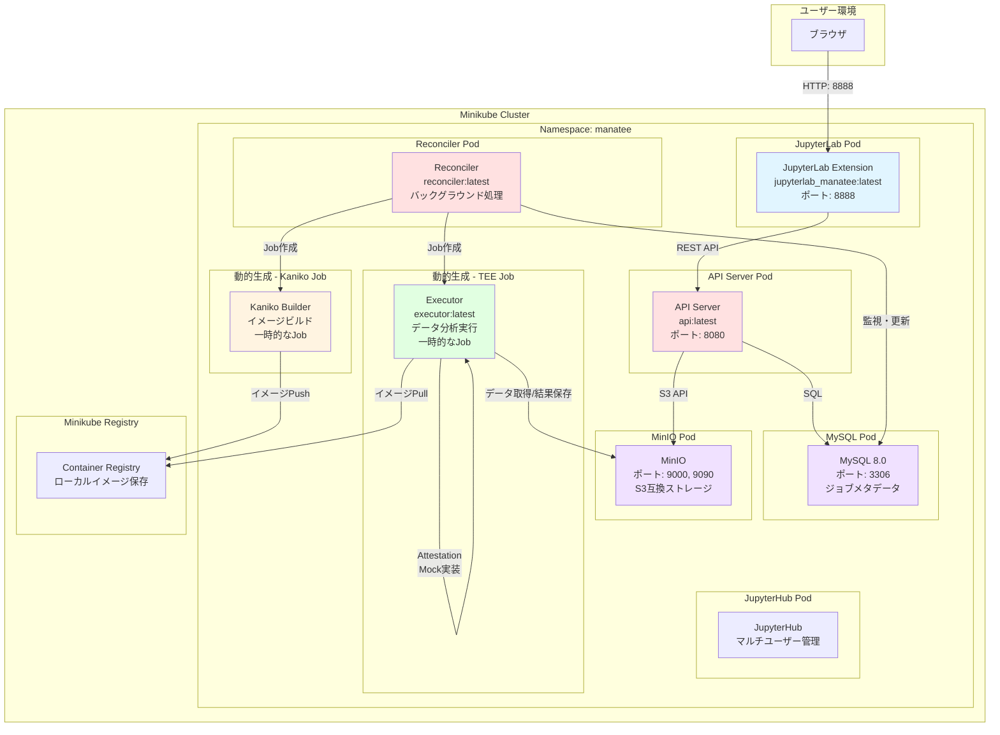
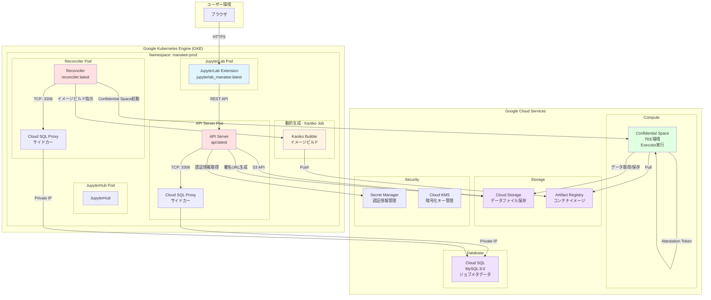
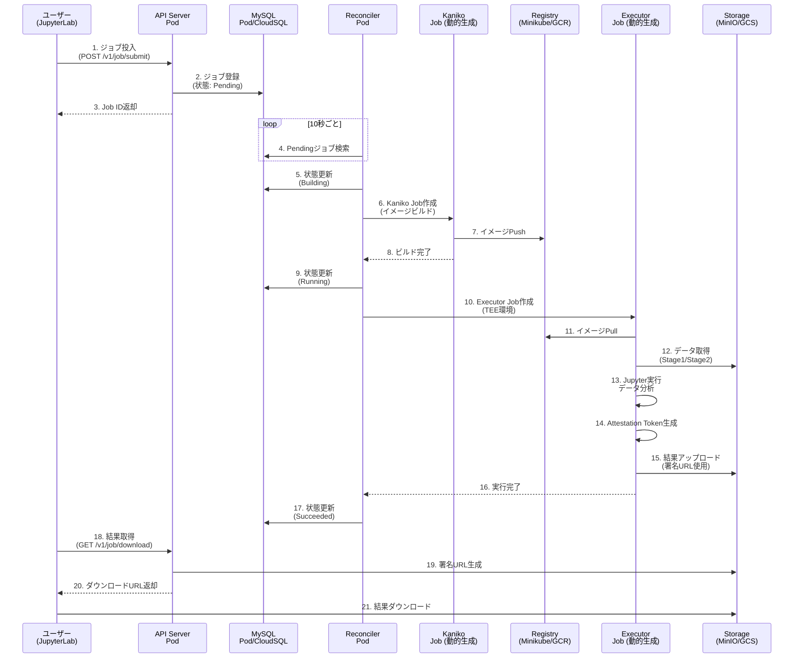

# ManaTEE - Data Clean Room Platform

ManaTEEは、複数企業間でプライバシーを保護しながらデータ分析を行うための**Data Clean Room**プラットフォームです。Google Cloud Platform (GCP)のConfidential Computing技術を活用し、TEE (Trusted Execution Environment) 環境でセキュアなデータ処理を実現します。

---

## 概要

ManaTEEは、以下の特徴を持つData Clean Roomフレームワークです：

- ✅ **プライバシー保護**: 生データを共有せず、ハッシュ化されたデータのみを使用
- ✅ **計算の透明性**: 実行されたコードがAttestation Tokenで検証可能
- ✅ **結果の信頼性**: TEE環境で生成された結果は改ざん不可能
- ✅ **柔軟な分析**: Jupyter Notebookで自由な分析ロジックを記述
- ✅ **スケーラビリティ**: Kubernetesベースでクラウドスケール

---

## クイックスタート

### ローカル環境での開発

```bash
bash SETUP_MINIKUBE.sh
```
**👉 [SETUP_MINIKUBE.md](SETUP_MINIKUBE.md) - ローカル開発環境セットアップ (Minikube)ガイド**

### VS Codeでのデバッグ環境

VS Code上でステップ実行可能なデバッグ環境を構築できます：

**👉 [DEBUG.md](DEBUG.md) - VS Code デバッグ環境構築ガイド**

### 本番環境（GCP）

GCP環境へのデプロイ方法は以下のドキュメントを参照してください：

**👉 [BUILD.md](BUILD.md) - ビルド・デプロイ詳細ガイド**

---

## 技術スタック

ManaTEEは以下の技術で構築されています：

### コンテナ・オーケストレーション
- **Docker** - コンテナイメージのビルド・実行
- **Kubernetes** - マイクロサービスのオーケストレーション
- **Helm** - アプリケーションのパッケージ管理

### ビルドツール・言語
- **Bazel/Bazelisk** - 統合ビルドシステム（Go、TypeScript、Python）
- **Go 1.23.8+** - バックエンドサービス（API、Reconciler）
- **Python 3.8+** - データ分析環境、JupyterLab拡張
- **TypeScript/React** - フロントエンドUI

### データベース・ストレージ
- **MySQL 8.0** - ジョブメタデータ管理
- **MinIO / Google Cloud Storage** - オブジェクトストレージ

### Jupyter環境
- **JupyterLab 4.0+** - データ分析・ノートブック実行環境
- **JupyterHub** - マルチユーザー管理

### セキュリティ・TEE
- **GCP Confidential Space** - TEE環境（本番）
- **Attestation Token (OIDC JWT)** - TEE検証メカニズム
- **Mock TEE** - ローカル開発環境

---

## アーキテクチャ

### コンポーネント構成

ManaTEEは以下の4つの主要コンポーネントで構成されています：

| コンポーネント | 言語 | 役割 | コンテナ定義 |
|---------------|------|------|------------|
| **API Server** | Go | REST API提供、ジョブ管理 | [`app/api/BUILD.bazel`](app/api/BUILD.bazel) |
| **Reconciler** | Go | ジョブライフサイクル管理 | [`app/reconciler/BUILD.bazel`](app/reconciler/BUILD.bazel) |
| **Executor** | Python | TEE環境でのデータ分析実行 | [`app/executor/BUILD.bazel`](app/executor/BUILD.bazel) |
| **JupyterLab Extension** | TypeScript/Python | UI・ジョブ投入 | [`app/jupyterlab_manatee/BUILD.bazel`](app/jupyterlab_manatee/BUILD.bazel) |

### 1. API Server (`api:latest`)
- **ベースイメージ**: `gcr.io/distroless/base` (Google Distroless)
- **実行プロセス**: Go製HTTPサーバー (Hertz フレームワーク)
- **ポート**: 8080
- **役割**: 
  - JupyterLab拡張からのリクエストを受信
  - ジョブの作成・管理・状態確認のREST API提供
  - MySQLでのジョブメタデータ管理
  - ストレージへのアクセス用署名URL発行

### 2. Reconciler (`reconciler:latest`)
- **ベースイメージ**: `gcr.io/distroless/base`
- **実行プロセス**: Go製バックグラウンドプロセス (10秒間隔で実行)
- **役割**:
  - ジョブ状態の監視・調整
  - Kanikoを使ったDockerイメージビルド管理
  - TEEバックエンド（GCP Confidential Space / Mock）での計算実行管理
  - ジョブライフサイクルの完全管理（8つの状態遷移）

### 3. Executor (`executor:latest`)
- **ベースイメージ**: `quay.io/jupyter/scipy-notebook` (JupyterLab + 科学計算環境)
- **実行プロセス**: Python Jupyter環境 + Attestation生成ツール
- **含まれるツール**:
  - `gen_custom_token`: TEE環境での認証トークン生成バイナリ
  - Jupyter Notebook実行環境
  - NumPy, SciPy, Pandas等の科学計算ライブラリ
- **役割**:
  - セキュアな計算環境でのデータ分析実行
  - TEE Attestation Tokenの生成・検証
  - 分析結果の署名とアップロード

### 4. JupyterLab Extension (`jupyterlab_manatee:latest`)
- **ベースイメージ**: `quay.io/jupyter/scipy-notebook`
- **含まれるコンポーネント**:
  - JupyterLab拡張パッケージ (.whl)
  - Node.js環境 (フロントエンド TypeScript/React)
  - Python拡張サーバー (Tornado)
  - カスタム起動フック (`20custom-hook.sh`)
- **役割**:
  - JupyterLabのサイドバーUI提供
  - Data Clean Roomジョブの投入・監視
  - データソースの管理
  - 分析結果の取得・表示

### 補助コンテナ

#### Minikube環境（ローカル開発）
- **MySQL 8.0**: [`deployment/minikube/mysql-deployment.yaml`](deployment/minikube/mysql-deployment.yaml)
- **MinIO**: [`deployment/minikube/minio-dev.yaml`](deployment/minikube/minio-dev.yaml)

#### GCP環境（本番）
- **Cloud SQL Proxy**: [`deployment/manatee/templates/deployment.yaml`](deployment/manatee/templates/deployment.yaml#L126-L139)

---

## Kubernetesアーキテクチャ図

### Minikube環境（ローカル開発）



### GCP本番環境



### コンポーネント間通信フロー



### 主な違い: Minikube vs GCP

| 項目 | Minikube (ローカル開発) | GCP (本番環境) |
|------|------------------------|---------------|
| **Kubernetesクラスタ** | Minikube (ローカルK8s) | Google Kubernetes Engine (GKE) |
| **データベース** | MySQL Pod (K8s内) | Cloud SQL + Cloud SQL Proxy (サイドカー) |
| **ストレージ** | MinIO Pod (K8s内) | Google Cloud Storage |
| **レジストリ** | Minikube内蔵レジストリ | Artifact Registry |
| **TEE環境** | Mock (K8s Job) | Confidential Space (GCE) |
| **Attestation** | Mock実装 (ダミートークン) | 実際のAttestation Token (OIDC JWT) |
| **ネットワーク** | NodePort | LoadBalancer / Ingress |
| **ノードプール** | シングルノード | CPU Pool + GPU Pool (オートスケーリング) |
| **セキュリティ** | 最小限 | Workload Identity, Secret Manager, KMS, IAM |
| **インフラ管理** | 手動 (kubectl) | Terraform (IaC) |

### GCP環境の詳細

#### Google Kubernetes Engine (GKE) 構成
- **クラスタ名**: `dcr-{env}-cluster`
- **ロケーション**: 単一ゾーン (例: `us-central1-a`)
- **ネットワーク**: カスタムVPC (`data_clean_room_network`)
- **Workload Identity**: 有効 (Podへのサービスアカウント紐付け)
- **Datapath**: `ADVANCED_DATAPATH` (高性能ネットワーク)

#### ノードプール構成
1. **GPU Node Pool** (`dcr-{env}-node-pool`)
   - マシンタイプ: `n2-standard-8` (デフォルト)
   - GPU: NVIDIA L4 x 1 (ML/AI ワークロード用)
   - Confidential Nodes: 有効 (TDX)
   - オートスケーリング: 0-3 ノード
   - 最大実行時間: 4時間

2. **CPU Node Pool** (`dcr-{env}-node-pool-cpu`)
   - マシンタイプ: `n2-standard-4` (デフォルト)
   - API Server, Reconciler, JupyterHub 実行用
   - オートスケーリング: 最大3ノード

#### Terraformリソース定義
- **GKEクラスタ**: [`resources/global/cluster.tf`](resources/global/cluster.tf)
- **VPCネットワーク**: [`resources/global/network.tf`](resources/global/network.tf)
- **サービスアカウント**: [`resources/global/service_accounts.tf`](resources/global/service_accounts.tf)

---

## Kubernetes依存性について

**ManaTEEは現在Kubernetes環境が必須です**。以下の理由により、Docker Composeでの代替は困難です：

### Kubernetes固有の機能依存
1. **Kaniko Image Builder**: 
   - KubernetesのJob APIを使用してDockerイメージをビルド
   - `k8s.io/client-go/kubernetes`ライブラリでJob作成・監視・削除
   
2. **Mock TEE Backend**:
   - KubernetesのBatch Job APIで計算処理を実行
   - Pod内のサービスアカウント・ネームスペース情報を取得
   
3. **InCluster Configuration**:
   - `rest.InClusterConfig()`でKubernetesクラスタ内認証
   - `/var/run/secrets/kubernetes.io/serviceaccount/`のサービスアカウント情報に依存

### 代替案
Docker Composeで動作させるには、以下の改修が必要です：
1. Image Builder抽象化（Docker API使用）
2. Job Runner改修（Docker APIでのコンテナ実行・監視）
3. 認証メカニズム変更（Kubernetes依存の汎用化）

現状では、**Minikube（ローカルKubernetes）が最も簡単な開発環境**です。

---

## AWS上でのデプロイ構成（TEE環境含む）

ManaTEEをAWS上でTEE環境を含めて運用する場合の推奨構成：

### AWSサービス構成

- **Amazon EKS**: Kubernetes環境
- **AWS Nitro Enclaves**: TEE環境（Confidential Space相当）
- **Amazon RDS for MySQL**: ジョブメタデータ
- **Amazon S3**: データストレージ
- **Amazon ECR**: コンテナレジストリ

### 制約・注意事項
- **現状はGCP専用**: 公式にはAWS対応なし（改修必要）
- **開発工数**: TEE Backend実装、Attestation処理で数週間～数ヶ月

詳細は **[BUILD.md](BUILD.md)** を参照してください。

---

## ドキュメント

| ドキュメント | 内容 |
|-------------|------|
| **[SETUP_MINIKUBE.md](SETUP_MINIKUBE.md)** | ローカル開発環境の構築手順とチュートリアル |
| **[BUILD.md](BUILD.md)** | ビルド・デプロイの詳細手順（GCP本番環境含む） |
| **[FUNCTION.md](FUNCTION.md)** | 各コンポーネントの機能仕様とAPI詳細 |
| **[USECASE.md](USECASE.md)** | 実践的なユースケース（広告コンバージョン分析等） |

---

## ライセンス

このプロジェクトのライセンスは [LICENSE](LICENSE) ファイルを参照してください。

---

## コントリビューション

コントリビューションを歓迎します！詳細は以下を参照してください：

- [CODE_OF_CONDUCT.md](CODE_OF_CONDUCT.md)
- [CONTRIBUTING.md](CONTRIBUTING.md)

---

## 参考資料

- [GCP Confidential Computing](https://cloud.google.com/confidential-computing)
- [GCP Confidential Space](https://cloud.google.com/confidential-computing/confidential-space/docs)
- [Attestation Token 仕様](https://cloud.google.com/confidential-computing/confidential-space/docs/attestation)
- [Bazel公式ドキュメント](https://bazel.build/)
- [JupyterHub公式ドキュメント](https://jupyterhub.readthedocs.io/)
