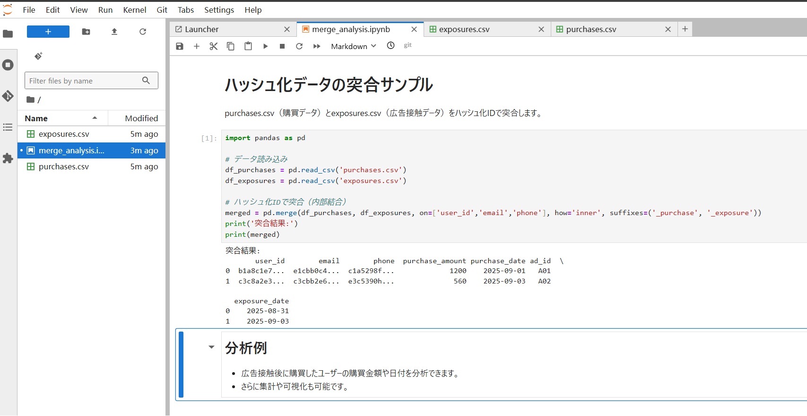

# ManaTEE ローカル開発環境セットアップ (Minikube)

このドキュメントは、Minikubeを使用してローカルPC上にManaTEEのテスト環境を構築し、チュートリアルを実行する手順について説明します。

**注意:** この環境は実際のTEE（Trusted Execution Environment）を使用しないため、セキュリティ機能の検証ではなく、アプリケーションの動作確認や開発を目的としています。

---

## 概要

開発とテストを容易にするため、GCP環境を必要としないMinikubeベースのセットアップが用意されています。`SETUP_MINIKUBE.sh` スクリプトは、必要なツールのインストールからManaTEEのデプロイまで、環境構築の全プロセスを自動化します。

### Minikube環境の特徴

| 項目 | Minikube (ローカル開発) | GCP (本番環境) |
|------|------------------------|---------------|
| **Kubernetesクラスタ** | Minikube (ローカルK8s) | Google Kubernetes Engine (GKE) |
| **データベース** | MySQL Pod (K8s内) | Cloud SQL + Cloud SQL Proxy (サイドカー) |
| **ストレージ** | MinIO Pod (K8s内) | Google Cloud Storage |
| **レジストリ** | Minikube内蔵レジストリ | Artifact Registry |
| **TEE環境** | Mock (K8s Job) | Confidential Space (GCE) |
| **Attestation** | Mock実装 (ダミートークン) | 実際のAttestation Token (OIDC JWT) |
| **ネットワーク** | NodePort | LoadBalancer / Ingress |
| **ノードプール** | シングルノード | CPU Pool + GPU Pool (オートスケーリング) |
| **セキュリティ** | 最小限 | Workload Identity, Secret Manager, KMS, IAM |
| **インフラ管理** | 手動 (kubectl) | Terraform (IaC) |

---

## 1. 前提条件

スクリプトは以下のツールが不足している場合、自動でインストールを試みます。

### 必要なツール
- **Docker** - コンテナイメージのビルド・実行
- **Bazelisk** - ManaTEEのビルドシステム
- **Minikube** - ローカルKubernetesクラスタ
- **kubectl** - Kubernetesクラスタ管理
- **mc (MinIO Client)** - オブジェクトストレージ操作

### システム要件
- **OS**: Linux, macOS, Windows (WSL2)
- **メモリ**: 8GB以上推奨
- **ディスク**: 20GB以上の空き容量
- **CPU**: 4コア以上推奨

---

## 2. ローカル環境構築

環境構築に必要なすべてのステップは `SETUP_MINIKUBE.sh` にまとめられています。

### 実行コマンド

リポジトリのルートディレクトリで以下のコマンドを実行してください。

```bash
bash SETUP_MINIKUBE.sh
```

### SETUP_MINIKUBE.shが実行する処理

このスクリプトは以下の処理を自動実行します：

1. **既存環境のクリーンアップ**
   - 既存のMinikubeクラスタを削除

2. **Minikubeクラスタの作成**
   - 新しいKubernetesクラスタを起動
   - 内蔵レジストリの有効化

3. **コンテナイメージのビルド**
   ```bash
   bazelisk build //app/...
   ```
   - API Server, Reconciler, Executor, JupyterLab拡張をビルド

4. **イメージのロード**
   - ビルドしたイメージをMinikubeレジストリにロード

5. **Kubernetesリソースの作成**
   - MySQL Deployment/Service
   - MinIO Pod/Service
   - Namespace作成

6. **ManaTEEのデプロイ**
   - HelmチャートでAPI Server, Reconcilerをデプロイ

7. **JupyterHubのデプロイ**
   - JupyterHub Helmチャートのインストール

### 実行時間

初回実行時は、イメージのダウンロードとビルドのため、**約15-30分**かかります。

---

## 3. デプロイの確認

環境構築が完了したら、以下のコマンドで各コンポーネントの状態を確認できます。

### Podの状態確認

```bash
kubectl get pods -n manatee
```

期待される出力例：
```
NAME                                READY   STATUS    RESTARTS   AGE
api-xxxxxxxxxx-xxxxx                1/1     Running   0          5m
reconciler-xxxxxxxxxx-xxxxx         1/1     Running   0          5m
mysql-deployment-xxxxxxxxxx-xxxxx   1/1     Running   0          5m
minio                               1/1     Running   0          5m
```

### サービスの状態確認

```bash
kubectl get svc -n manatee
```

期待される出力例：
```
NAME            TYPE       CLUSTER-IP      EXTERNAL-IP   PORT(S)                         AGE
api-service     NodePort   10.96.xxx.xxx   <none>        8080:30080/TCP                  5m
mysql-service   NodePort   10.96.xxx.xxx   <none>        3306:30306/TCP                  5m
minio-service   NodePort   10.96.xxx.xxx   <none>        9000:30900/TCP,9090:30909/TCP   5m
```

---

## 4. チュートリアルの実行

環境構築が完了したら、チュートリアル用のデータを準備し、JupyterLabで分析を実行します。

### ステップ1: データ準備

`tutorials` ディレクトリに移動し、データ準備用のスクリプトを実行します。

```bash
cd tutorials
bash run_tutorial_jp.sh
```

このスクリプトは以下の処理を実行します：

1. **MinIOへの接続**
   - Minikube上のMinIOサービスに接続

2. **バケット作成**
   - `stage1` バケット (企業Aのデータ用)
   - `stage2` バケット (企業Bのデータ用)

3. **サンプルデータのアップロード**
   - CSVファイルをMinIOにアップロード

### ステップ2: JupyterLabへのアクセス

`run_tutorial_jp.sh` の実行が完了すると、ターミナルにアクセス方法が表示されます。

通常は以下のコマンドでJupyterLabにアクセスできます：

```bash
# JupyterHubのURLを取得
minikube service jupyter -n jupyterhub --url
```

ブラウザで表示されたURLにアクセスしてください。

### ステップ3: ノートブックの実行

JupyterLabにアクセスしたら、以下の手順でチュートリアルを実行します。

---

## 5. ２社間データ突合サンプル

### サンプルデータの場所

チュートリアル用のサンプルファイルは `tutorials/` ディレクトリに配置されています：

- **分析ノートブック**: [`tutorials/code/merge_analysis.ipynb`](tutorials/code/merge_analysis.ipynb)
- **購買データ**: [`tutorials/data/stage1/purchases.csv`](tutorials/data/stage1/purchases.csv)
- **広告接触データ**: [`tutorials/data/stage2/exposures.csv`](tutorials/data/stage2/exposures.csv)

### データ形式

#### purchases.csv (企業A: 購買データ)
```csv
user_id,email,phone,purchase_amount,purchase_date
b1a8c1e7...,e1cbb0c4...,c1a5298f...,1200,2025-09-01
c2b7a1d2...,b2cbb1d5...,d2b5399g...,3400,2025-09-02
c3c8a2e3...,c3cbb2e6...,e3c5390h...,560,2025-09-03
d4d9b3f4...,d4cbb3f7...,f4d5391i...,780,2025-09-04
```

#### exposures.csv (企業B: 広告接触データ)
```csv
user_id,email,phone,ad_id,exposure_date
b1a8c1e7...,e1cbb0c4...,c1a5298f...,A01,2025-08-31
c3c8a2e3...,c3cbb2e6...,e3c5390h...,A02,2025-09-03
e5e0b4g5...,e5cbb4g8...,g5e5392j...,A03,2025-09-05
```

### 実行方法

1. JupyterLabでノートブックを開く:
   ```
   tutorials/code/merge_analysis.ipynb
   ```

2. ノートブックを順番に実行

3. または、JupyterLabに3つのファイルをアップロードして実行することもできます

### 実行結果

実行結果は以下の通りです。



---

## 6. データハッシュ化のベストプラクティス

サンプルデータ（`purchases.csv`と`exposures.csv`）は、user_id、email、phoneを「SHA256でハッシュ化した値（ダミー値）」にしています。

### ハッシュ化ルール

実際にデータをやり取りする２社間で、以下のルールを統一してください：

#### 1. アルゴリズム
- **SHA256** または **SHA512** などの安全なハッシュ関数を使用

#### 2. ソルト（追加文字列）
- 同じ値でも異なるハッシュ値になるよう、事前に合意した「ソルト」を付与

### ハッシュ化サンプルコード

```python
import hashlib

def hash_value(value, salt="your_salt"):
    """
    値をSHA256でハッシュ化
    
    Args:
        value: ハッシュ化する値
        salt: ソルト（両社で事前に合意）
    
    Returns:
        ハッシュ化された値（16進数文字列）
    """
    return hashlib.sha256((salt + value).encode()).hexdigest()

# 使用例
email = "user@example.com"
salt = "agreed_secret_salt_2025"
hashed_email = hash_value(email, salt)
print(f"元の値: {email}")
print(f"ハッシュ値: {hashed_email}")
```

### セキュリティ上の注意点

1. **ソルトの共有**: オフラインまたは暗号化通信で安全に共有
2. **ソルトの管理**: 定期的に変更し、安全に保管
3. **ハッシュアルゴリズム**: 両社で同じアルゴリズムとソルトを使用
4. **PII（個人識別情報）の保護**: 生データは絶対に共有しない

---

## 7. トラブルシューティング

### Minikubeが起動しない

```bash
# Minikubeのログを確認
minikube logs

# Minikubeを再起動
minikube delete
minikube start
```

### Podが起動しない

```bash
# Podの詳細を確認
kubectl describe pod <pod-name> -n manatee

# Podのログを確認
kubectl logs <pod-name> -n manatee
```

### イメージのビルドエラー

```bash
# Bazelのキャッシュをクリア
bazelisk clean --expunge

# 再ビルド
bazelisk build //app/...
```

### MinIOに接続できない

```bash
# MinIOのサービスを確認
kubectl get svc minio-service -n manatee

# MinIOのポートフォワード
kubectl port-forward svc/minio-service 9000:9000 -n manatee
```

---

## 8. 環境のクリーンアップ

テストが完了したら、以下のコマンドで環境を削除できます。

```bash
# Minikubeクラスタの削除
minikube delete

# すべてのリソースを削除
kubectl delete namespace manatee
kubectl delete namespace jupyterhub
```

---

## 9. 次のステップ

ローカル環境での動作確認が完了したら、以下のドキュメントを参照してください：

- **[BUILD.md](BUILD.md)** - ビルドとデプロイの詳細手順
- **[FUNCTION.md](FUNCTION.md)** - 各コンポーネントの機能仕様
- **[USECASE.md](USECASE.md)** - 実践的なユースケースと詳細な分析例
- **[README.md](README.md)** - ManaTEEのアーキテクチャと技術スタック

---

## 参考資料

- [Minikube公式ドキュメント](https://minikube.sigs.k8s.io/docs/)
- [Bazel公式ドキュメント](https://bazel.build/)
- [JupyterHub公式ドキュメント](https://jupyterhub.readthedocs.io/)
- [MinIO公式ドキュメント](https://min.io/docs/)
